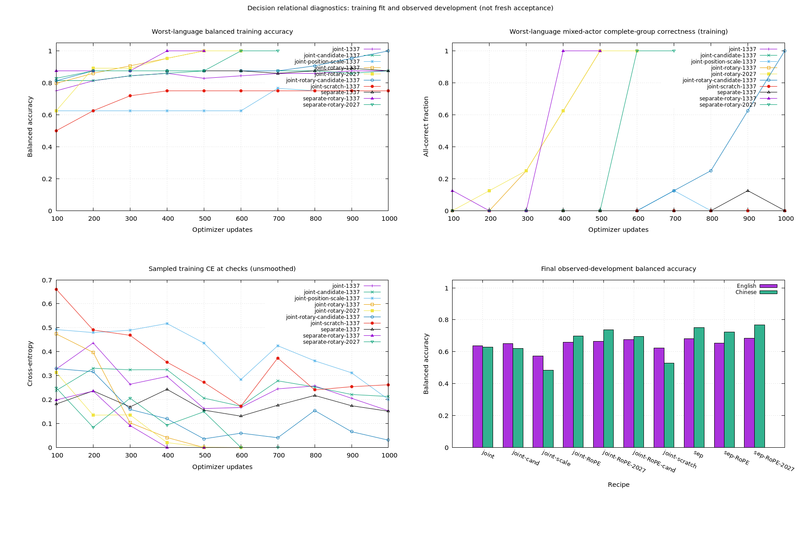
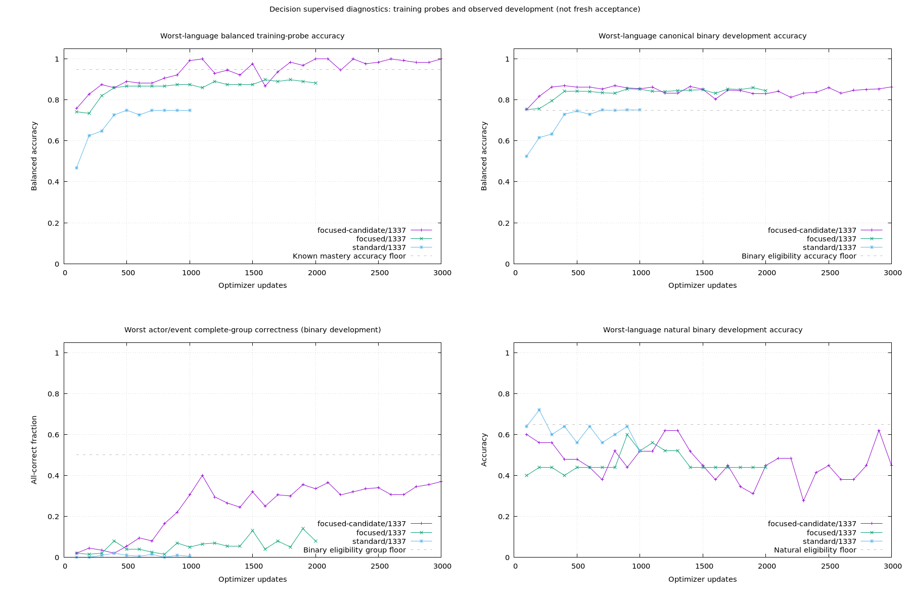

# Decision v0.5 — relational encoding diagnostic

Status: **completed, 2026-10-19**. The [extended optimization goal](extended-optimization-plan.md) finishes ten fitting runs and three supervised pilots, totaling **14,500 successful CUDA optimizer updates**, including 100 replayed updates. Joint/RoPE and separate/RoPE both give repeatable fitting improvements, but no supervised checkpoint meets all bilingual relation and natural-development gates. **No factual model is promoted; v0.1 remains delivered.** This is a negative conclusion for the tested recipes and resources, not an impossibility claim. The [compact machine-readable results](v05-results.json) preserve final metrics and provenance hashes.

## Primary comparison

Both recipes start from our own v0.1 parent and tokenizer, with explicitly verified shared-tensor transfer and fresh optimizers. The reviewed v0.4 fitting core is unchanged: 128 rows, two complete training families, English and Chinese, actor and event counterfactuals. The full 128-row set is training material; its scores do not measure generalization.

Both use seed 1337, FP32, LR 0.0003, zero dropout/warmup, effective batch 32, microbatch 4, accumulation 8, plain candidate CE and 1,000 CUDA updates. Joint encoding omits separate interaction/matching modules, so this compares representation recipes rather than a parameter-matched attention ablation.

| Recipe | Updates | Fit balanced accuracy EN / ZH | Mixed actor groups EN / ZH | Mixed event groups EN / ZH | Fit gate |
| --- | ---: | ---: | ---: | ---: | --- |
| Separate | 1,000 | 87.5% / 87.5% | 0% / 0% | 100% / 100% | Failed |
| Joint | 1,000 | 87.5% / 87.5% | 0% / 0% | 100% / 100% | Failed |

The frozen gate requires >=99% balanced accuracy and >=90% actor **and** event mixed-group correctness in each language for two consecutive checks. No checkpoint met it. Intermediate accuracy fluctuations do not change this outcome. Candidate order is permuted during training; labels and auxiliary metadata are not input features.

On the previously observed binary development panel (1,600 rows per language), final separate accuracy is 68.125% EN / 75.1875% ZH; joint is 63.625% / 62.9375%. Mixed-actor complete-group correctness remains only 3.5% / 7.5% for separate and 6% / 1% for joint. These are development observations, not fresh acceptance or evidence of a useful factual preview.

## Correctness evidence

Input auditing finds no opposite-label tokenization collisions. Representative actor swaps in both languages retain different ordered sequences with the same state-token multiset. Joint candidate answer masks select the actual option tokens without state/question tokens. No truncation occurs on the fitting audit.

Core tests check explicit transfer and rejection of incompatible architectures, padding invariance, positional permutation sensitivity, effective gradients, exact resumed updates, candidate permutation/chunking with numeric/string IDs, effective gradient accumulation, and independent actor/event fit guards. A synthetic positional-signal test demonstrates computation order sensitivity, not semantic correctness of random weights.

Raw protocol/data/weights/history live under the ignored `runs/decision/relational-v05/`. Original source snapshots in `source-v05-frozen/` match the pre-training SHA-256 manifest byte for byte. Follow-up recipes have separate frozen configs and source snapshots. Existing v0.4 artifacts are preserved.

## Reproduction and diagnostic weights

From a fresh output directory, with the existing v0.4 reviewed artifacts and own v0.1 parent available:

```bash
OMP_NUM_THREADS=1 MKL_NUM_THREADS=1 bundle exec ruby benchmarks/decision/relational_encoding.rb --phase prepare --output runs/decision/relational-v05-replay
OMP_NUM_THREADS=1 MKL_NUM_THREADS=1 bundle exec ruby benchmarks/decision/relational_encoding.rb --phase audit --output runs/decision/relational-v05-replay
OMP_NUM_THREADS=1 MKL_NUM_THREADS=1 bundle exec ruby benchmarks/decision/relational_encoding.rb --phase fit --arm separate --output runs/decision/relational-v05-replay
OMP_NUM_THREADS=1 MKL_NUM_THREADS=1 bundle exec ruby benchmarks/decision/relational_encoding.rb --phase fit --arm joint --output runs/decision/relational-v05-replay
```

Training prefers CUDA with recorded CPU fallback. Replays of these data are regression experiments, not new acceptance. Completed output directories are protected from accidental replacement.

```ruby
predictor = EasyAI::Decision::Predictor.load(
  "runs/decision/relational-v05/fit-separate-rotary-1337/choice", device: "auto"
)
# Final supervised diagnostic; also uncalibrated and unqualified for delivery:
supervised = EasyAI::Decision::Predictor.load(
  "runs/decision/relational-v05/pilot-focused-candidate/seed-1337/choice", device: :auto
)
```

This example loads an uncalibrated fitting checkpoint. Its tiny-set gate passes, but its observed generalization does not qualify it for delivery. No factual model is promoted. Fitting weights never initialize a full supervised pilot. Unknown supervision, calibration and reserved acceptance remain gated.

An actual CPU load through `Predictor.load` passes both `:cpu` and `"cpu"`, numeric/string option IDs, JSON serialization, zero truncation, and probability-mass checks on one fitting record per language. Reversing candidates while changing chunk size from one to two changes probabilities by at most `1.23e-14`. The results are in `diagnostics/public-interface-smoke.json`; these are interface checks, not semantic acceptance.

## Follow-up hypotheses

The first two frozen interventions change one factor relative to joint: candidate-only pooling, or additive position scale 0.2 instead of 0.02. Each has an independent 1,000-update ceiling and unchanged fitting gates. They test dilution and positional-signal hypotheses. Subsequent relative-position and fresh-initialization controls are recorded below.

## Completed follow-up fits

All rows below use the same reviewed 128-row training core and the same original fitting gate. Nonqualifying runs retain their failures. The two positional interventions are distinct: additive scale changes the existing sinusoidal recipe, whereas RoPE replaces the positional function. The fresh-initialization control keeps the own tokenizer but resets all network tensors.

| Joint recipe | Seed | Updates | Fit balanced accuracy EN / ZH | Mixed actor groups EN / ZH | Mixed event groups EN / ZH | Gate |
| --- | ---: | ---: | ---: | ---: | ---: | --- |
| Candidate-only pooling | 1337 | 1,000 | 87.5% / 87.5% | 0% / 0% | 100% / 100% | Failed |
| Sinusoidal scale 0.2 | 1337 | 1,000 | 96.875% / 75% | 75% / 0% | 100% / 50% | Failed |
| RoPE | 1337 | 600 | 100% / 100% | 100% / 100% | 100% / 100% | Passed at checks 500 and 600 |
| Fresh initialization | 1337 | 1,000 | 89.0625% / 75% | 25% / 0% | 100% / 50% | Failed |
| RoPE confirmation | 2027 | 600 | 100% / 100% | 100% / 100% | 100% / 100% | Passed at checks 500 and 600 |

The seven completed fits consume 6,200 optimizer updates. RoPE gives a repeatable **fitting-recipe improvement** over this round's joint sinusoidal reference. It does not establish general semantic understanding: seed-1337 RoPE's observed development balanced accuracy is only 65.875% EN / 69.6875% ZH, with mixed-actor complete-group correctness 8.5% / 4.5%.



Curves are checkpoint measurements, without smoothing. The loss panel shows sampled training-batch CE at checks, not a full-dataset loss or a gradient plot. The development panel is observed development, not reserved acceptance. Its compact labels abbreviate separate as `sep`, candidate pooling as `cand`, and omit seed 1337; seed 2027 remains explicit.

CPU/CUDA checks on four fitting records give maximum logit differences of `9.54e-6` for separate and `5.36e-6` for joint sinusoidal. Eight repeated inference measurements remain at 172 MiB and 176 MiB respectively. These are measured diagnostic cases on this machine, not peak-memory or latency guarantees. All twelve encoder query/key/value projection weights change in both primary recipes, ruling out an entirely frozen attention stack in these runs.

The separate/RoPE fitting checkpoint also passes the four-record CPU/CUDA comparison (`4.77e-6` maximum logit difference); eight repeated GPU measurements are all 178 MiB. Its checkpoint weights SHA-256 is `d7621a4a619a87cc99461dcd16c550fdb8814159b92dce2d4301cb79688102c1`. The common original parent weights SHA-256 is `a143ceacc22ae0d0184de7452554c68a7bfd71f029ef68d15f5dcd909234c135`; tokenizer fingerprint is `5461faeec44b059b21cd8dc711877c39a92e3bb66422ce9ab460f1db045c8f87`. The actual parent uses NativeBpe ByteLevel; its ID vocabulary is preserved throughout. Tiny Ruby ByteBpe fixtures in tests are not substituted into real checkpoints.

## Supervised generalization

After the two-seed fitting success, the selected joint/RoPE recipe restarts from the original own v0.1 parent with a fresh optimizer. Fitting weights are not reused. The bounded pilot uses the v0.5 schedule: at most 1,000 known-stage updates, with the full 2,000-update budget available only after known mastery. Actor and event training-probe groups must each pass; aggregate binding cannot conceal actor failures.

The frozen mixture contains 60% controlled, 20% qualified natural examples and 20% routing replay, with the existing bilingual exposure schedule. Natural training is only 30 English and 22 Chinese decisions, below the desired 200 per language. The deficit is explicit and is not filled by automatically accepting disputed public labels.

For natural development, 87 previously unused short public examples were reviewed target-blind by one assistant reviewer. Only original-label agreements without exclusions are retained: 29 English known decisions; Chinese has 25 known and 16 insufficient-evidence decisions. Eight examples are excluded and nine disagree with original labels; disagreements are retained in the audit but do not become automatic relabels. Related public questions can share a premise, so row counts do not imply independent family counts. This is not independent human agreement.

The original v0.4 controlled calibration/acceptance and natural acceptance material remain reserved. Exposure auditing checks the failed v0.4 fitting result, its frozen runner's stop path, actual artifacts, and v0.5 fitting code paths; absence of an opened marker alone is not the basis for calling it unused. Input/label review and integrity qualification before freezing the pilot are disclosed and separate from checkpoint evaluation.

The own-parent natural-development binary accuracy is 55.17% EN / 48% ZH. Canonical binary balanced accuracy is 51.875% / 51%. These baselines and all candidate selection rules are frozen before pilot training. No new factual preview is delivered at this stage.

The standard joint/RoPE pilot stops at 1,000 known-stage updates, with no eligible checkpoint. Its final training-probe balanced accuracy is 75% EN / 75.78125% ZH; complete actor groups are 0% / 6.25%, and event groups 0% / 6.25%. It never reaches unknown supervision.

The focused joint/RoPE alternative also stops, at its separately frozen 2,000-update known ceiling. Final training-probe balanced accuracy is 96.875% EN / 88.28125% ZH; actor groups 75% / 25%, event groups 100% / 87.5%. No profile qualifies and no second full-training seed is justified for either failed recipe. Their original runs and stop rules are preserved.

The corrective separate/RoPE focused pilot passes its known mastery at checks 1,000 and 1,100, then completes 1,900 joint-stage updates, reaching its 3,000-update ceiling. Its final known training probe is 100% in both languages, including both relation groups. Nevertheless, **none of its 30 development checkpoints qualifies**. A separate reconstruction of eligibility and known-stage transition from the saved history agrees with the controller (`pilot-focused-candidate/selection-audit.json`); this is not a missed-checkpoint selection bug.

| Final corrective development profile | Balanced EN / ZH | Complete actor groups EN / ZH | Complete event groups EN / ZH | Natural accuracy EN / ZH |
| --- | ---: | ---: | ---: | ---: |
| Known-only binary | 87.3125% / 86.375% | 39.5% / 37% | 82% / 73.5% | 44.828% / 68% |
| Three-state | 71.625% / 65.271% | 27.5% / 19% | 61.5% / 43.5% | 20.690% / 43.902% |

Three-state recall is EN support 74.25%, contradiction 72.25%, unknown 68.375%; ZH 67.75%, 67.125%, 60.9375%. All three recalls must reach 70% in each language, with the separate actor/event and natural guards also passing. Binary actor groups must reach 50% in each language, and natural accuracy at least 65%; neither requirement is met jointly. The English natural panel has no three-state unknown labels, so its raw accuracy cannot establish unknown detection.



Curves use all saved checkpoint measurements without smoothing; different panels show different requirements, not interchangeable success measures. The two failed joint/RoPE pilots remain failed. No supervised recipe is development-eligible, so full-training second-seed confirmation, calibration, reserved acceptance, final-model runtime qualification and preview packaging are skipped by design. The two fitting confirmations are not full-training confirmations. Reserved acceptance remains unopened, and no v0.5 factual preview exists.

## Corrective representation comparison

After the joint/RoPE focused pilot failed its 2,000-update known-stage gate, two additional fitting recipes were frozen. The original fitting selection and failed pilots are preserved separately.

| Recipe | Seed | Updates | Final fit balanced EN / ZH | Final actor groups EN / ZH | Final event groups EN / ZH | Gate |
| --- | ---: | ---: | ---: | ---: | ---: | --- |
| Joint/RoPE, candidate pooling | 1337 | 1,000 | 100% / 100% | 100% / 100% | 100% / 100% | Failed: only the final check passed |
| Separate/RoPE | 1337 | 500 | 100% / 100% | 100% / 100% | 100% / 100% | Passed at 400 and 500 |
| Separate/RoPE confirmation | 2027 | 700 | 100% / 100% | 100% / 100% | 100% / 100% | Passed at 600 and 700 |

The candidate-pooling result is deliberately retained as a failure: its Chinese actor groups were only 62.5% at update 900. A final perfect measurement does not satisfy the two-check rule. Separate/RoPE qualifies for a fresh supervised pilot from the original parent, using the same focused schedule; it does not inherit the tiny fitting weights. Ten fitting runs together consume 8,400 updates.

## Supplementary composition diagnostics

Supplementary composition checks were run on the seed-1337 separate/RoPE fitting checkpoint **after** its fitting selection and after the corrective supervised pilot had started. They are observed diagnostics, not prospectively independent acceptance or the basis for selecting that recipe.

| Development view | Balanced EN / ZH | Complete actor groups EN / ZH |
| --- | ---: | ---: |
| Canonical | 65.50% / 72.375% | 5% / 8% |
| Held expression | 66.50% / 70.0625% | 5% / 3% |
| Held option wording | 59% / 71% | 4% / 7.5% |
| Reversed record order | 65.75% / 72.75% | 5.5% / 8% |
| Events absent from controlled training | 52.5% / 75% | 0% / 0% |
| Complete families with new actor identities | 65.923% / 72.153% | 3.75% / 6.548% |

The extra-event panel has 160 rows per language; the actor-identity slices have 1,344 EN and 1,440 ZH rows. New means absent from this round's controlled training, not necessarily absent from parent training. Removing positional information from the already fitted model lowers training balanced accuracy to 87.5% and complete actor groups to 50% in both languages. This is an out-of-distribution mechanism diagnostic, not a trained position-free comparison. Adding an irrelevant note is also measured in the raw report, but exceeds the one/two-proposition contract and cannot establish supported robustness.

## Replaying conditional experiments

These commands operate on the prepared root, defaulting to `runs/decision/relational-v05`. Dependencies and terminal gates are checked; they are not a script to bypass failed prerequisites. Frozen selections cannot be overwritten.

```bash
bundle exec ruby benchmarks/decision/relational_encoding.rb --phase freeze-recipe --arm joint-rotary
bundle exec ruby benchmarks/decision/relational_encoding.rb --phase fit --arm joint-rotary
# After all initially registered fits finish, select and confirm the winner:
bundle exec ruby benchmarks/decision/relational_encoding.rb --phase select-fit
bundle exec ruby benchmarks/decision/relational_encoding.rb --phase fit --arm joint-rotary --seed 2027
bundle exec ruby benchmarks/decision/relational_encoding.rb --phase prepare-pilot
bundle exec ruby benchmarks/decision/relational_encoding.rb --phase pilot
bundle exec ruby benchmarks/decision/relational_encoding.rb --phase select-pilot
# The focused alternative requires a terminal failure of the previous pilot:
bundle exec ruby benchmarks/decision/relational_encoding.rb --phase prepare-pilot --variant focused
bundle exec ruby benchmarks/decision/relational_encoding.rb --phase pilot --variant focused
bundle exec ruby benchmarks/decision/relational_encoding.rb --phase report
bundle exec ruby benchmarks/decision/relational_encoding.rb --phase account-fit-tokens
```

Freeze/run every declared fitting arm before selection. The corrective comparison uses `--selection candidate` for fitting selection/confirmation and `--variant focused-candidate` for supervision. A second supervised seed is allowed only after development qualification. `calibrate`, `accept` and `package` enforce confirmation, frozen data/model/calibration hashes, once-only acceptance and actual acceptance success. Passing test fixtures for those paths does not mean the real trained models qualify.

`fit-token-accounting.json` reconstructs exact uniform fitting visits, unpadded tokens and padded encoder inputs from the frozen sampler, and checks the observed counters. It does not estimate focused-pilot padding or FLOPs. Raw traces also record actual device, examples, token counts and session timing; process-memory samples do not establish a continuous peak. The GPU is a Quadro RTX 3000 with 6 GiB, with a 4,096 MiB process budget, FP32 throughout.

### Runtime collection amendment

During the corrective pilot, full development evaluation was much slower than training. A runtime-only change makes the relational pilot collect Ruby's temporary tensor wrappers every eight evaluation batches instead of every batch. Batch size remains four, with identical records, ordering, padding, logits, metrics and training configuration. The shared evaluator's default remains one; fitting and historical experiments keep that default. A final collection also handles a partial interval or exception.

CPU tests compare both encoding paths and unchanged live parameters. A real CUDA checkpoint audit repeats intervals `1, 8, 1, 8` over controlled binary/three-state and natural development records: logits are exactly equal in every pass, all parameter values and identities are unchanged, and sampled process memory is at most 840 MiB. The audit checks the 4,096 MiB budget between batches. These sampled timings include concurrent training and memory polling and are not a production speed or continuous-peak guarantee.

The pilot is interrupted after 1,500 logged updates and resumes from its saved update-1,400 checkpoint. The 100 already executed updates and their deterministic replay both count toward the total ceiling. Original source snapshots remain intact; `source-runtime-collection-frozen/`, `pilot-focused-candidate/evaluation-runtime-amendment.json` plus its hash, and `diagnostics/collection-runtime-audit.{json,rb}` record the new source, unchanged scientific protocol hash, checkpoint and comparison. This changes evaluation resource management, not a failed scientific stop rule or an acceptance threshold.

`diagnostics/resume-replay-audit.json` compares all trace fields for updates 1,401–1,500 before and after resuming: all 100 match exactly, including losses, LR, preclip gradient norm, device and architecture version. This is an actual CUDA replay check in addition to the deterministic tiny-model resume tests; it does not establish generalization.

## Interpretation limits

These runs compare the existing 256-wide, four-layer architecture paths, the own v0.1 tokenizer/parent and the reviewed local task. They do not test larger language models, external pretrained encoders, distillation, RL, a new tokenizer or broad task-aligned natural-language pretraining. Those are untested research directions, not additional failed methods. The small qualified natural set is a documented coverage limit; this experiment does not isolate it as the unique cause of failure.

The focused alternative changes batching, curriculum, LR and regularization together. Its comparison assesses a complete recipe, not an isolated optimizer or curriculum effect. No model-size, optimizer-family or learning-rate grid search is claimed. RoPE's repeated tiny-fit success establishes an improvement for those representation recipes on those training rows; it does not uniquely establish why the original sinusoidal recipe failed, or that every sinusoidal model would fail.

The finite recipe list has terminal gates and a shared ceiling. Remaining budget is not a requirement to keep searching after those comparisons conclude. The negative result is limited to these tested recipes and resources; it cannot prove neural factual scoring impossible. No threshold adjustment, post-hoc actor/event averaging, disputed-label adoption or acceptance-informed checkpoint selection is used to manufacture qualification.

## Final disposition and verification

All eight registered representation recipes and three conditional supervised recipes have terminal outcomes. There are ten fitting runs because the two qualifying representations each receive a second fitting seed. Fitting consumes 8,400 updates; the supervised pilots consume 1,000, 2,000 and 3,000 logical updates, plus 100 replayed updates. The total is **14,500 / 20,000**, with no observed CPU fallback. Remaining budget is deliberately unused after the registered comparisons conclude. The checkpoint counter for the corrective pilot records 96,000 logical example visits; its 100 replayed updates add 3,200 actual visits and are counted separately in trace totals. No global pilot padded-token or FLOP equality is claimed.

The supported improvement is **repeatable relational fitting with the tested RoPE recipes**. The intended deliverable—reliable shared EN/ZH factual scoring under the declared relation and natural-data checks—is not achieved by these runs. A causal claim about data volume, capacity, tokenization or pretraining would need a different experiment; none is inferred from this failure.

Verification: production **249 tests / 6,322 assertions**, Learning **81 / 327**, all passing; RuboCop **355 files**, no offenses. Tests cover closed-form/numerical and behavioral correctness, transfer, gradients, batching, resume, balanced group sampling, publication guards, frozen calibration, once-only acceptance and positive/negative packaging workflows with controlled prediction fixtures. They do not assert convergence or semantic accuracy of random models. Actual CUDA replay, inference parity, interface and resource checks are recorded separately above. Logs: `tmp/decision-extended-final-{tests,learning,lint}.log`.
