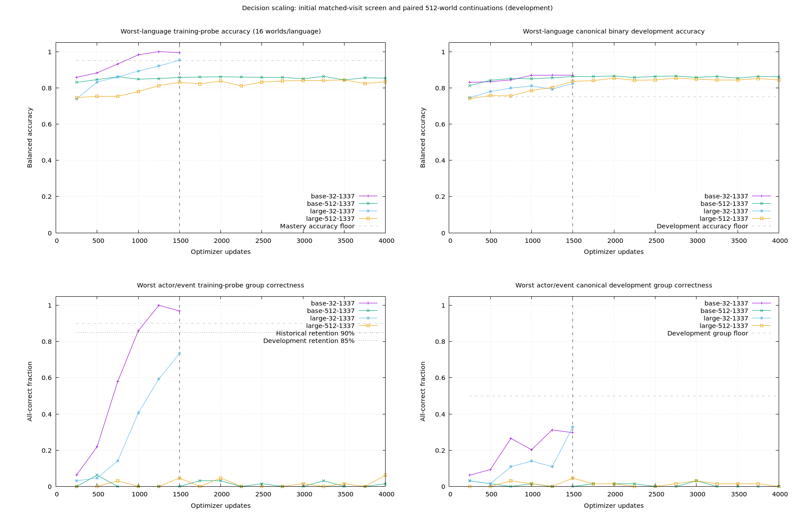
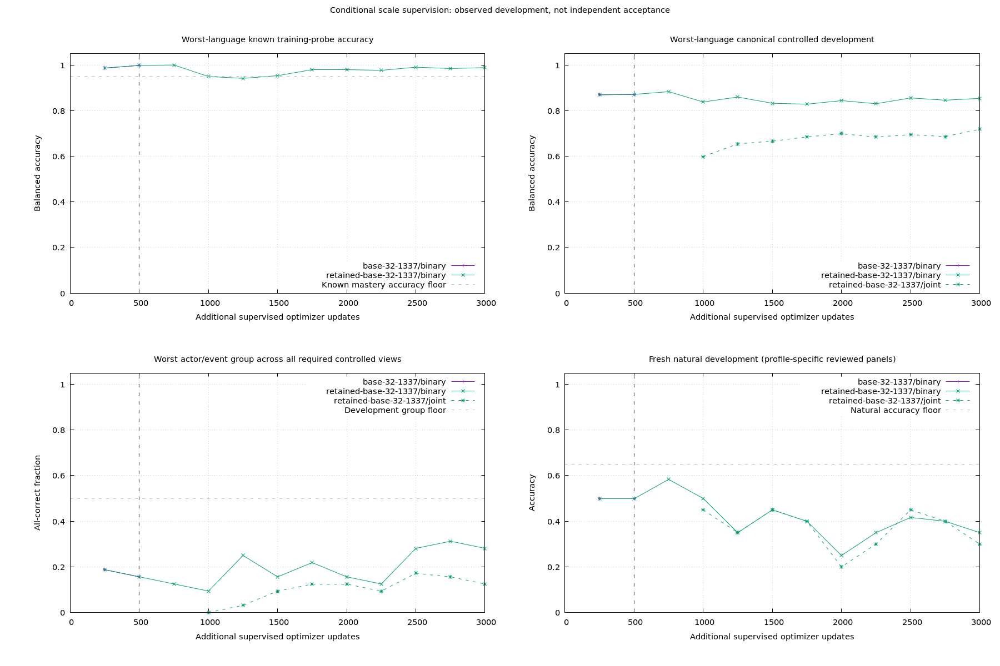

# Decision v0.6 — scaling data and model capacity

Status: **completed, 2026-10-19**. The [frozen experiment plan](v06-plan.md) and separately registered supervised/corrective stages finish at **14,042 successful CUDA optimizer updates**. The small-data base model learns its training relation; the tested increases in data and capacity do not establish a consistent held-out binding improvement. No v0.6 factual model is promoted; v0.1 remains the delivered preview. [Compact results](v06-results.json) retain outcomes, counts and provenance hashes.

The [user-authorized development policy amendment](v06-diagnostic-policy.md) lowers the retention group floor from 90% to 85%. Development progress is judged from held-out trends and useful accuracy under the local GPU limit, separately from release eligibility. Historical protocols and results retain their original thresholds.

## Controlled comparison

The initial factorial compares **32 vs 512 worlds per language** and **6,627,841 vs 20,431,617 parameters**. These are 2,048 vs 32,768 binary training rows. Each world includes four independent truth assignments, both claims, both assertion polarities and both record orders. Each model uses the same own v0.1 tokenizer/parent, separate encoding, RoPE, AdamW, effective batch 32 and 1,500 initial updates. This matches updates and example visits, not FLOPs or input tokens.

| Profile | Encoder blocks | FFN width | Parameters |
| --- | ---: | ---: | ---: |
| Base | 4 | 768 | 6,627,841 |
| Medium, capacity probe only | 8 | 1,536 | 12,807,425 |
| Large | 12 | 2,048 | 20,431,617 |

Depth/FFN expansion preserves the transferred base RoPE function through identity residual blocks and zero-output added FFN units. CPU tests check gradients into added capacity and exact optimizer/sampling resume. An actual-parent/tokenizer audit on eight bilingual examples finds zero initial logit difference across all three profiles. This comparison is against the base **RoPE transfer**, not the original sinusoidal parent's outputs.

Zero output weights are intentional at initialization. `--phase audit-parameters` compares completed checkpoints with their seeded initial tensors on CPU. The large/32 checkpoint has nonzero added attention/FFN output weights, including the last block, confirming that these branches moved during training. RMS/change statistics remain diagnostics: a weight histogram or parameter movement cannot certify semantic quality.

Allocation derives offsets from reserved counts: training 512, development 32, calibration 32, test 128 gives **0 / 512 / 544 / 576**. Smaller training datasets share nested prefixes without moving held-out reservations. The default historical generator preserves its old outputs, while the scaling generator uses finite, nonrepeating actor/event catalogs and rejects exhausted allocations. Canonical, seen-actor/new-combination and novel-actor development slices must each pass; novel-event performance is diagnostic.

Before learning, a cross-round audit rejected the first data draft because 12 test records matched earlier materials. The rejected draft and hashes remain archived. Replacement actor names are disjoint from legacy controlled names; the replacement passes literal record exclusion against **121 prior local data panels / 262,380 unique materials**. All current panels also pass independent gold, contrast completeness, cross-panel material/family separation and token-limit checks. Maximum observed inputs are 35 state tokens and 37 question/option tokens, with zero truncation.

## Completed initial screens

Each cell finishes 1,500 CUDA updates and 48,000 example visits. An endpoint metadata audit confirms identical row-visit arrays and unpadded input-token totals between capacities at each data scale. Balanced accuracy below is observed binary development; training accuracy is the fixed probe, not the entire training set.

| Capacity / worlds per language | Training probe, worst language | Canonical EN | Canonical ZH | Known mastery | All controlled gates |
| --- | ---: | ---: | ---: | --- | --- |
| Base / 32 | 99.414% | 87.109% | 92.773% | Pass | Fail |
| Base / 512 | 85.742% | 86.328% | 86.523% | Fail | Fail |
| Large / 32 | 95.313% | 84.766% | 82.422% | Fail | Fail |
| Large / 512 | 83.008% | 83.594% | 83.984% | Fail | Fail |

At matched initial visits, increasing data changes worst-language canonical balanced accuracy by **−0.781 percentage points for base / +1.172 points for large**. Increasing capacity lowers this metric at both data scales. These are one-seed development comparisons, not a universal scaling law or independent acceptance. The larger-data cells are still unmastered. Their mean row exposure is 1.465 visits, with 7,688 of 32,768 rows unvisited; the small-data cells average 23.438 visits and cover every row. Sampling is with replacement, so these are not completed epochs.

An offline replay of the actual sampler also reproduces every logged row visit and unpadded input token. Padding occupies about **9.14%** of controlled state/option encoder slots for the small dataset and **9.41%** for the large dataset. This counts encoder input slots, not attention/matching FLOPs. Recorded `session_seconds` values are process-local intervals at canonical checks; they exclude startup and later endpoint views and restart on resume. They are not a complete GPU throughput benchmark.

Aggregate accuracy conceals binding failures: base/512 canonical mixed-actor complete-group correctness is **0% EN / 3.125% ZH**, while event groups reach **90.625% / 96.875%**. Base/32 fits its training probe but fails held-out actor/composition groups. No initial cell qualifies as a factual model.

For an analytical reference, a scorer that solves event worlds perfectly, solves homogeneous-truth actor worlds, and scores mixed-truth actor claims at 50% can reach `0.5 × 1 + 0.5 × (0.5 × 1 + 0.5 × 0.5) = 87.5%` balanced accuracy. It can still get zero mixed-actor pairs entirely correct. This illustrates the metric's limitation; it does not identify this model's internal algorithm.

Both 512-world capacities complete the preregistered continuation to 4,000 total updates. The opposite-sign initial data changes are both smaller than three points, so the conditional 128-world midpoint is not run. These extended endpoints remain separate from the matched initial factorial: comparing a 4,000-update large-data model with a 1,500-update small-data model cannot isolate a data-size effect.

| Capacity / 512 worlds, 4,000 updates | Canonical balanced EN / ZH | Canonical actor groups EN / ZH | Canonical event groups EN / ZH |
| --- | ---: | ---: | ---: |
| Base | 86.133% / 86.914% | 0% / 1.563% | 93.750% / 98.438% |
| Large | 84.375% / 85.352% | 0% / 3.125% | 78.125% / 81.250% |

At 4,000 updates neither larger-data cell masters the fixed training probe. On mixed-truth actor pairs involving novel actors, **both questions are correct** in 0% / 0% of pairs for base and 0% / 3.125% for large. Single-question accuracy on that slice is 46.875% / 50% and 50% / 48.438%, respectively. The [correctness audit](v06-binding-audit.md) independently reproduces these counts and explains why correlated answers fall below the 25% expected pair score of independent guessing. Thus the remaining limitation is substantial actor binding, rather than a marginal 89% versus 90% retention decision. Greater capacity and the longer tested training window do not establish an improvement here.

The extended large-data cells average **3.906 row visits**, still below the small-data screen's 23.438. Equal mean exposure would require 24,000 updates per large-data cell under this sampler, which was not tested. These results therefore do not establish that data scaling fails after convergence, or that the larger model has an optimal training schedule.



## Conditional natural and unknown supervision

The controlled selection chooses base/32. Target-blind review retains **303 new natural training records** (140 English, 163 Chinese); with 64 previously qualified records, the combined natural pool contains 367 unique records. This is single-assistant review, not independent human validation. Fresh binary natural development is label-balanced before predictions: 20 English and 12 Chinese rows. Joint development has 20 English and 25 Chinese rows. These small panels have substantial uncertainty; one binary Chinese error changes accuracy by 8.33 points. Previously observed v0.5 natural development is reported separately as regression.

The [original supervised recipe](v06-supervised-plan.md) completes its fixed 500-update retention stage and stops under the historical 90% policy: the Chinese actor check at 250 is 57/64 (89.0625%), followed by 63/64 at 500, leaving only one consecutive passing check. Under the user's 85% development amendment, both checks pass. Preserve that distinction: the terminal outcome is a policy/window failure, not a demonstration that the architecture cannot learn.

The separately frozen [corrective branch](v06-retention-plan.md) inherits that step-500 model and optimizer, then increases known replay from 16/32 to 24/32 examples until retention passes. It passes the original 90% floor at 750, carrying the valid step-500 check, and starts joint supervision at 751. Its recorded trajectory therefore uses the later transition; the untrained step-501 alternative under 85% has no measured joint outcome.

The corrected recipe completes **3,000 supervised updates**, including the inherited 500: 750 known-stage and 2,250 joint-stage updates. Its final training probe is 100% EN / 98.828% ZH balanced accuracy, with actor/event groups 100% / 96.875%. Final observed controlled development is:

| Profile / view | Balanced EN / ZH | Actor pairs EN / ZH | Event pairs EN / ZH |
| --- | ---: | ---: | ---: |
| Binary / canonical | 87.109% / 85.352% | 42.188% / 53.125% | 65.625% / 51.563% |
| Binary / seen combinations | 85.156% / 85.547% | 43.750% / 31.250% | 53.125% / 65.625% |
| Binary / novel actors | 82.031% / 81.641% | 28.125% / 28.125% | 53.125% / 71.875% |
| Joint / canonical | 71.810% / 74.935% | 28.125% / 48.438% | 59.375% / 48.438% |
| Joint / seen combinations | 69.206% / 75.195% | 34.375% / 28.125% | 35.938% / 46.875% |
| Joint / novel actors | 69.531% / 70.443% | 12.500% / 28.125% | 43.750% / 62.500% |

Joint canonical balanced accuracy rises from 59.831% / 63.021% at the first joint measurement (step 1,000) to 71.810% / 74.935% at 3,000. That is useful observed learning progress, rather than a causal architecture comparison or independent confirmation. English natural performance does not follow the same trend: final binary accuracy is **7/20 EN / 7/12 ZH**, and joint is **6/20 EN / 13/25 ZH**. No checkpoint passes all held-out relation and natural criteria. Full-recipe confirmation, calibration and reserved acceptance are therefore skipped; this does not erase the narrower fitting and learning improvements.



The plotted histories share their first 500 updates; they are not independent replications. Joint curves start only when joint predictions are actually measured. The vertical line marks the original retention ceiling. Natural curves use profile-specific reviewed panels, so binary and joint percentages do not constitute a matched-label comparison.

The final update ledger contains 42 successful feasibility updates, 6,000 initial controlled updates, 5,000 continuation updates, 500 original supervised updates and 2,500 new corrective updates. Inherited updates count once. All recorded updates execute on CUDA with finite trace values. Core verification passes **269 tests / 6,457 assertions**; lint checks **382 files** clean. Six controlled endpoints pass diagnostic CPU and CUDA loading, normalized JSON probabilities and candidate permutation checks. These are runtime checks, not semantic acceptance.

## Measured CUDA feasibility

The local Quadro RTX 3000 has 6,144 MiB VRAM; experiments enforce a 4,096 MiB per-process budget. FP32 probes include forward, backward, gradient clipping and AdamW state, at effective batch 32. Full-shape probes use the configured 256/64 token limits and 2, 3 and 18 candidates.

| Probe | Result | Sampled process memory |
| --- | --- | ---: |
| Base, full limits, microbatch 4 | Pass | up to 2,606 MiB |
| Medium, full limits, microbatch 4 | Budget failure at 18 candidates | 4,696 MiB |
| Large, full limits, microbatch 4 | CUDA OOM at 18 candidates | not a completed measurement |
| Large, full limits, microbatch 2 | Budget failure at 18 candidates | 4,124 MiB |
| Large, full limits, microbatch 1 | Pass | up to 2,496 MiB |
| Base, controlled 48/48 binary inputs, microbatch 16 | Pass | up to 724 MiB |
| Large, controlled 48/48 binary inputs, microbatch 16 | Pass | up to 2,060 MiB |

Both factorial capacities use the passed common controlled microbatch 16 with accumulation 2. The broader full-input stage must use its separately qualified microbatch. Resource failures do not count as failed semantic experiments. These are memory samples, not continuous peaks; medium with smaller microbatches and models beyond the listed profiles are untested. The probes consumed 42 actual optimizer updates, including successful updates preceding resource failures.

## Reproduce and inspect

The ignored local experiment root is `runs/decision/scaling-v06/`. It contains frozen source/config/plan snapshots, data and parent/tokenizer hashes, rejected data, resource failures, optimizer traces and checkpoints. Preserve it when reproducing: completed trials cannot be overwritten. Reproduction requires the own v0.1 parent artifact and a compatible native tokenizer; no external pretrained weights are used.

For replay on the **same GPU/library setup**, copy frozen inputs into a fresh directory. Reuse the existing feasibility evidence, but do not copy optimizer traces, fitted checkpoints or selection results. This repeats the original data/configuration; it is not a fresh independent acceptance sample. A different GPU/library setup needs its own feasibility probes and protocol.

```bash
bundle exec ruby -rfileutils -rjson -rdigest <<'RUBY'
source = File.expand_path("runs/decision/scaling-v06")
output = File.expand_path("runs/decision/scaling-v06-replay")
abort "Preserve existing replay" if File.exist?(output)
FileUtils.mkdir_p(output)
%w[protocol.json protocol.json.sha256.json data data-audit.json
   cross-round-audit.json baseline.json baseline.json.sha256.json
   plan-frozen.md source-frozen natural-review].each do |name|
  FileUtils.cp_r(File.join(source, name), File.join(output, name))
end
protocol = JSON.parse(File.read(File.join(source, "protocol.json")))
protocol.dig("hardware", "results_sha256").each_key do |name|
  FileUtils.mkdir_p(File.dirname(File.join(output, name)))
  FileUtils.cp(File.join(source, name), File.join(output, name))
  manifest = File.join(File.dirname(name), "initialization.json")
  FileUtils.cp(File.join(source, manifest), File.join(output, manifest))
end
File.write(File.join(output, "replay-origin.json"), JSON.pretty_generate(
  source: source,
  protocol_sha256: Digest::SHA256.file(File.join(source, "protocol.json")).hexdigest,
  scope: "Frozen input replay; preflight results reused, old optimizer updates excluded."
))
RUBY
```

Run the phases below from the project root; the new output directory keeps all fitted results independent of the retained original run.

```bash
export OMP_NUM_THREADS=1 MKL_NUM_THREADS=1
SCALING_REPLAY_ROOT=runs/decision/scaling-v06-replay
bundle exec ruby benchmarks/decision/scaling.rb --output "$SCALING_REPLAY_ROOT" --phase train --profile base --scale 32 --limit 1500
bundle exec ruby benchmarks/decision/scaling.rb --output "$SCALING_REPLAY_ROOT" --phase train --profile base --scale 512 --limit 1500
bundle exec ruby benchmarks/decision/scaling.rb --output "$SCALING_REPLAY_ROOT" --phase train --profile large --scale 32 --limit 1500
bundle exec ruby benchmarks/decision/scaling.rb --output "$SCALING_REPLAY_ROOT" --phase train --profile large --scale 512 --limit 1500
bundle exec ruby benchmarks/decision/scaling.rb --output "$SCALING_REPLAY_ROOT" --phase extensions
```

Use the frozen extension decision before any 4,000-update continuation or conditional 128-world midpoint. The shared ceiling is 30,000 actual successful experimental updates, including probes and replays. Reports retain initial screens separately from extended endpoints. Training probes cover 16 worlds per language and are not full-training accuracy. Canonical development is checked every 250 updates; the other controlled slices are checked at registered endpoints.

For the measured decision in this round, continue both 512-world cells and then run the conditional supervised phases. These replay commands preserve the **historical 90% policy**; they do not simulate an earlier transition under 85%. The prior v0.4 training review and v0.5 natural regression/routing artifacts referenced by the supervised preparation must also be available locally.

```bash
bundle exec ruby benchmarks/decision/scaling.rb --output "$SCALING_REPLAY_ROOT" --phase train --profile base --scale 512 --limit 4000
bundle exec ruby benchmarks/decision/scaling.rb --output "$SCALING_REPLAY_ROOT" --phase train --profile large --scale 512 --limit 4000
bundle exec ruby benchmarks/decision/scaling.rb --output "$SCALING_REPLAY_ROOT" --phase select
bundle exec ruby benchmarks/decision/scaling.rb --output "$SCALING_REPLAY_ROOT" --phase prepare-supervised
bundle exec ruby benchmarks/decision/scaling.rb --output "$SCALING_REPLAY_ROOT" --phase supervised-baseline
bundle exec ruby benchmarks/decision/scaling.rb --output "$SCALING_REPLAY_ROOT" --phase supervised --profile base
bundle exec ruby benchmarks/decision/scaling.rb --output "$SCALING_REPLAY_ROOT" --phase select-supervised
```

Only if the primary reproduces the documented terminal 500-step window failure, prepare and run the separately registered corrective fork. The preparation checks that condition and preserves the original failed selection.

```bash
bundle exec ruby benchmarks/decision/scaling.rb --output "$SCALING_REPLAY_ROOT" --phase prepare-retained
bundle exec ruby benchmarks/decision/scaling.rb --output "$SCALING_REPLAY_ROOT" --phase retained
bundle exec ruby benchmarks/decision/scaling.rb --output "$SCALING_REPLAY_ROOT" --phase select-retained
bundle exec ruby benchmarks/decision/scaling.rb --output "$SCALING_REPLAY_ROOT" --phase audit-diagnostic-policy
bundle exec ruby benchmarks/decision/scaling.rb --output "$SCALING_REPLAY_ROOT" --phase audit-parameters
bundle exec ruby benchmarks/decision/scaling.rb --output "$SCALING_REPLAY_ROOT" --phase audit-padding
bundle exec ruby benchmarks/decision/scaling.rb --output "$SCALING_REPLAY_ROOT" --phase diagnostic-runtime --device cpu
bundle exec ruby benchmarks/decision/scaling.rb --output "$SCALING_REPLAY_ROOT" --phase diagnostic-runtime --device cuda
bundle exec ruby benchmarks/decision/scaling.rb --output "$SCALING_REPLAY_ROOT" --phase report
bundle exec ruby benchmarks/decision/scaling.rb --output "$SCALING_REPLAY_ROOT" --phase plot
bundle exec ruby benchmarks/decision/scaling.rb --output "$SCALING_REPLAY_ROOT" --phase plot-supervised
```

A controlled-only success is insufficient for factual delivery. Reviewed natural development, known/unknown retention, a second seed of the full selected recipe, separate calibration and unopened acceptance remain required. Previously observed v0.5 natural development is regression evidence only.

## Loading a diagnostic checkpoint

This example loads the completed large/32 binary experiment. It is an **unqualified diagnostic**, not a replacement for the delivered predictor or a reliable unknown detector. The input below comes from already observed controlled development. Local ignored artifacts are required.

Save the Ruby snippet as `tmp/v06_predict.rb` and run `bundle exec ruby -Ilib tmp/v06_predict.rb` from the project root.

```ruby
require "json"
require "easy_ai"

predictor = EasyAI::Decision::Predictor.load(
  "runs/decision/scaling-v06/arms/large-32-1337/choice",
  device: :auto,
  candidate_chunk_size: 1
)
row = File.foreach("runs/decision/scaling-v06/data/validation.jsonl")
  .lazy.map { |line| JSON.parse(line) }
  .find { |item| item.dig("world", "profile") == "binary" }
puts predictor.device
puts JSON.pretty_generate(predictor.probabilities(
  state: row.fetch("state"),
  question: row.fetch("question"),
  options: row.fetch("options")
))
```

`device: :auto` prefers CUDA and permits CPU inference fallback. Experimental training and GPU feasibility runs require actual CUDA. `--phase diagnostic-runtime --device cpu` (or `cuda`) checks loading, JSON, probability normalization and candidate permutation against observed development; these runtime checks do not measure semantic quality.

## Interpretation limits

The controlled comparison enlarges the dataset from the same own parent. It does not test gradually expanding a previously fitted small dataset. Width stays 256, depth and FFN width grow together, and all cells share the same optimizer recipe; intermediate-capacity learning, different learning-rate schedules and mixed precision are untested. Fresh controlled names are held from the relevant controlled training slice, not necessarily unseen as individual tokenizer pieces or in every historical pretraining source. Natural review is a single assistant review, and its available candidate inventory is not an exhaustive search of alternative hypotheses. Report any negative conclusion within these tested configurations and gates.
