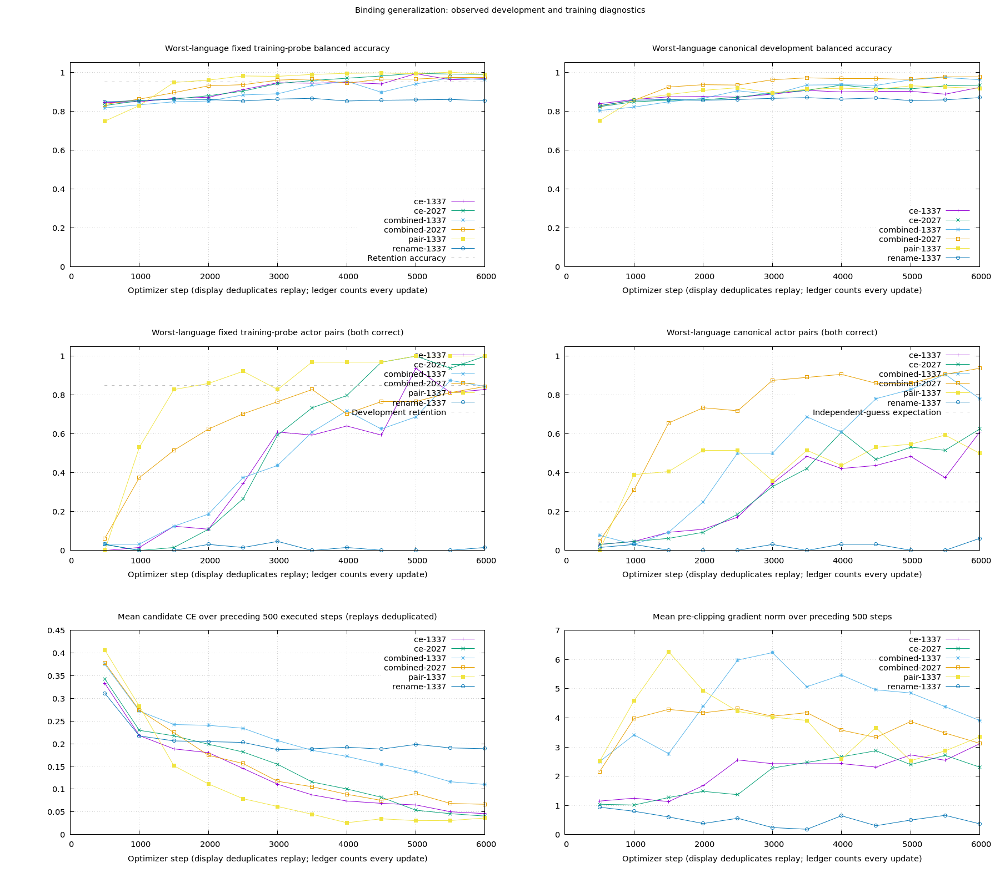

# Decision v0.7 — training sufficiency and transferable binding

Status: **completed, 2026-10-20**. See the [prospective experiment plan](v07-plan.md) and [machine-readable results](v07-results.json). Six independent 6,000-update endpoints complete at **36,087 actual CUDA updates**, including 12 feasibility updates and 75 replayed updates. Longer training improves novel-actor pairs at both seeds; **renaming plus actor-pair loss beats the matching CE reference at both seeds** under the frozen directional criterion. The separate interventions fail that criterion. This establishes a useful observed-development direction within the tested scope; v0.1 remains the delivered preview.

Four independent own-parent recipes use the 6.63M separate/RoPE model, 128 worlds per language, 8,192 binary training rows, effective batch 32, microbatch 16 and 6,000 updates. Their **23.4375 mean original-row visits** match the earlier 32-world/1,500-update reference. CE, renaming, pair coupling and their combination form a complete two-factor comparison. Equal mean visits do not establish equal convergence, FLOPs or unique augmented-surface coverage.

The renaming pool contains the 128 shared generator identities per language; it excludes the novel-actor pool. It can expand identity exposure beyond the names that happened to occur in the original 128-world facts. Thus renaming tests identity recombination and shared-pool coverage together. Replacements remain consistent across four queries about a state, preserve truth/polarity/order, and reject either rendering order of all reserved records. Newly held actor names never enter the augmentation pool. All reused development panels were already observed in v0.6; they are not fresh acceptance.

The auxiliary loss keeps CE and adds `.5 * softplus(1 - (z_yes_row - z_no_row))` averaged over complete mixed-truth actor pairs, where each row's `z` is `logit(yes) - logit(no)`. Candidate IDs determine the indexes after permutation. This encourages different scores for the opposite-label questions; CE still anchors absolute answers. It differs from the previously tested independent per-row hinge and sentence-level evidence head.

## Engineering checks

All four CUDA probes pass at 64 state tokens, 64 tokens per option, two candidates and effective batch 32. Sampled process memory is **718 MiB CE/renaming; 738 MiB pair/combined**, below the 4,096 MiB soft budget. These are sampled observations, not continuous peaks. Actual training rejects CPU fallback or a change in the 16 × 2 accumulation layout.

After those checks, the four independent primary arms run concurrently on the shared GPU. Per-arm file locks prevent a direct invocation and the controller from training into the same output simultaneously; completed endpoints are preserved. This changes resource scheduling, not seeds, model/data/loss/sampler configuration. Process-local intervals are not exclusive GPU throughput comparisons. The execution amendment is retained alongside the namespace correction.

Deterministic CPU tests check loss values and gradient signs, candidate permutation, repeated sampling of the same unit, complete-pair validation, gold-preserving renaming, reserved-material rejection, CE equivalence to the prior trainer and exact combined optimizer resume. Training effects are measured experiments, not unit-test assertions.

During setup, the new entrypoint initially collided with the repository's historical `generalization.rb` benchmark and its test filename. Those original files are restored. The v0.7 implementation now uses the independent `binding_generalization.rb` entrypoint and `DecisionBindingGeneralization` namespace. The CE process was interrupted after 825 successful updates and resumed from committed step 750; all 75 replayed updates remain in the trace and shared budget. A source comparison verifies identical trainer/experiment bodies after only the module rename. The runtime amendment, old/new source snapshots and numerical replay audit are retained under `namespace-correction/`.

The [reference-confirmation clarification](v07-exposure-confirmation.md) retains a seed-2027 CE reference even if no intervention beats CE. This independently checks the round's training-sufficiency question using the already allocated reference budget; the worst-case step allocation is unchanged. The original policy, linked amendments and byte-identical numerical training body remain archived.

The [runtime correction record](v07-runtime-amendments.md) also documents stale controller verification and the variant-to-result-path integrity lookup fix. The latter failed before any update; its deterministic tampering tests pass, and the original selection remains unchanged.

## Completed CE reference, seed 1337

The first 6,000-update endpoint covers every original training row at **23.4375 mean visits**. Full original-training balanced accuracy is **99.414% EN / 98.535% ZH**, with actor pairs **96.680% / 90.820%** and event pairs **99.414% / 99.219%**. The sampled probe's final actor/event minimum is 82.813%, and it does not obtain two consecutive retention passes. That historical diagnostic flag is not a claim that the full training corpus has the same lower score; fixed-budget training proceeds independently of it.

| Observed development view | Balanced EN / ZH | Actor pairs EN / ZH | Event pairs EN / ZH |
| --- | ---: | ---: | ---: |
| Canonical | 92.188% / 92.969% | 60.938% / 68.750% | 87.500% / 79.688% |
| Seen combinations | 91.992% / 91.797% | 53.125% / 59.375% | 90.625% / 85.938% |
| Novel actors | 94.141% / 89.453% | 23/32 = 71.875% / 12/32 = 37.500% | 84.375% / 81.250% |

The old 32-world/1,500-update novel-actor reference is 7/32 English and 10/32 Chinese full pairs. This is a promising one-seed observation at equal **mean per-row exposure**, with four times the worlds, optimizer updates and total example visits. It does not isolate data size at equal compute. Not every metric improves: Chinese canonical actor pairs are slightly below the old small-data result. Pair counts share worlds, and the novel-actor slice has only eight actor worlds per language.

Independent CPU and CUDA prediction audits reproduce all recorded classification metrics across the three required views. Public candidate-chunk/permutation checks agree with batched predictions on eight bilingual mixed-actor cases per endpoint. These are observed-development/runtime audits, not fresh acceptance.

The retained **CE/128 seed-1337 step-1,500 checkpoint** also permits a same-data learning-curve comparison. Its novel-actor pair correctness is 9/32 EN / 4/32 ZH; by step 6,000 this becomes 23/32 / 12/32. Canonical actor pairs rise from 14.063% / 9.375% to 60.938% / 68.750%, and seen-combination pairs from 17.188% / 7.813% to 53.125% / 59.375%. At seed 2027, novel-actor pairs similarly rise from **4/32 / 2/32** at 1,500 to **15/32 / 7/32** at 6,000. This read-only, post-training checkpoint analysis isolates training duration more closely than the historical cross-data comparison. It is not a new model-selection rule or an independent acceptance. Improvement repeats, but final scores vary substantially by seed; Chinese CE/2027 remains below the 25% independent-guess pair expectation.

## Fixed factorial, seed 1337

All four independent 6,000-update arms finish with identical original-row sampling coverage. The fixed endpoint is selected; intermediate development peaks are not substituted.

| Recipe | Canonical balanced EN / ZH | Novel-actor balanced EN / ZH | Novel-actor full pairs EN / ZH | Worst actor cell across three required views |
| --- | ---: | ---: | ---: | ---: |
| CE | 92.188% / 92.969% | 94.141% / 89.453% | 23/32 / 12/32 | 37.500% |
| Rename | 86.914% / 87.500% | 85.938% / 87.500% | 0/32 / 1/32 | 0% |
| Pair | 92.578% / 91.602% | 86.328% / 84.375% | 11/32 / 9/32 | 28.125% |
| Combined | 96.094% / 97.070% | 96.875% / 89.844% | 25/32 / 16/32 | 50.000% |

Only the combined intervention clears the frozen directional criterion: **12.5 percentage points** better on the worst actor cell, with no required-view/language balanced-accuracy regression. The minimum spans canonical, seen combinations and novel actors, separately in English and Chinese. The combination's canonical actor pairs are 78.125% / 92.188%; seen combinations are 81.250% / 68.750%. CE's final training-probe trend from step 5,000 to 6,000 declines, so the conditional 12,000-step CE extension is not triggered.

Renaming alone retains the actor-insensitive failure: independent novel-actor row accuracy on mixed actor cases is 46.875% / 50%, with identical predictions on 30/32 opposite-label pairs in both languages. Pair loss alone fits the training probe more quickly but generalizes worse than CE. Both failures remain part of the result. The combined arm has 57/64 / 45/64 correct mixed-actor rows and 25/32 / 16/32 full pairs. Chinese improvement includes more complete successes but also more entirely wrong pairs (3 versus CE's 1); it is not uniform error elimination.

Event generalization remains unresolved. On novel-event development, the combined arm's event-pair correctness is **0/32 EN / 7/32 ZH**, even though its actor-pair scores there are 43.750% / 78.125%. The required-view selection criterion targets actor binding and does not guarantee event retention.

## Independent seed confirmation

| Seed | CE novel-actor balanced EN / ZH | Combined balanced EN / ZH | CE novel-actor full pairs EN / ZH | Combined full pairs EN / ZH | Worst required actor cell: CE → combined |
| --- | ---: | ---: | ---: | ---: | ---: |
| 1337 | 94.141% / 89.453% | 96.875% / 89.844% | 23/32 / 12/32 | 25/32 / 16/32 | 37.500% → 50.000% |
| 2027 | 90.234% / 87.109% | 93.359% / 96.875% | 15/32 / 7/32 | 19/32 / 24/32 | 21.875% → 59.375% |

The frozen five-point worst-actor improvement and maximum three-point per-cell balanced regression rules pass at **both seeds**. Seed-2027 combined canonical balanced accuracy is 99.023% / 97.656%, with actor pairs 93.750% / 95.313%; seen-combination balanced accuracy is 95.508% / 98.438%, with actor pairs 84.375% / 96.875%. Reference and candidate have identical original-row sampling coverage within each seed. No additional seed or recipe is searched after confirmation.

The fixed probe's historical `known_mastery` flag is false for both combined endpoints, yet full original-training actor pairs exceed 90% in both languages at seed 2027. That flag requires two consecutive sampled-probe passes; it does not block this fixed-budget directional comparison or erase measured development improvements. Neither equal steps nor this flag proves equal convergence. Auxiliary weighting changes gradients and clipping as well as the paired objective.

The pretrained diagnostic is **not triggered** because the complete primary factorial finds an improving own-model recipe. No pretrained weights are downloaded or used. The conditional CE extension is also not triggered. The round ends within its registered budget rather than spending unused updates on further search.

Useful direction is confirmed for these observed synthetic binary panels. Novel-event event pairs remain only **4/32 EN / 9/32 ZH** at combined/2027, compared with 0/32 / 7/32 at seed 1337. Unknown handling, natural expressions, routing retention and fresh acceptance are outside this completed comparison. New-person pairs share just eight actor worlds per language; two seeds on the same panel are not two independent datasets. This supports further work on the recipe, not broad factual competence, calibrated confidence or Jev parity.

## Reproduction and evidence



The curves use the fixed training probe and canonical development; complete required-view endpoints remain separate. CE and gradient panels average the preceding 500 logical steps, displaying each replayed step once, while the ledger counts every execution. The auxiliary objective changes both coupling and the relative weight of mixed actor cases; this factorial does not isolate coupling from reweighting. Sampled loss spikes and training-fit improvements do not alone establish held-out reasoning.

The local root is `runs/decision/generalization-v07/` (ignored). It contains frozen training/development files, parent/source/data hashes, both-order held-material exclusions, the original and corrected source snapshots, feasibility records, optimizer checkpoints and all traces. Existing output is protected from replacement.

```bash
export OMP_NUM_THREADS=1 MKL_NUM_THREADS=1
bundle exec ruby benchmarks/decision/binding_generalization.rb --phase prepare --output runs/decision/generalization-v07-replay
bundle exec ruby benchmarks/decision/binding_generalization.rb --phase preflight --output runs/decision/generalization-v07-replay
# Run each of ce, rename, pair, combined independently:
bundle exec ruby benchmarks/decision/binding_generalization.rb --phase train --variant ce --steps 6000 --output runs/decision/generalization-v07-replay
```

Preparation requires the retained v0.6 data/audit and own v0.1 parent locally. Reusing these data produces a development replay, not a new acceptance panel. Complete all four arms before `--phase select`. The frozen selection controls a possible 12,000-step CE endpoint and second-seed candidate/reference comparisons; do not extend failed recipes arbitrarily. The conditional pretrained diagnostic would require its own frozen protocol if no primary intervention improved; it is not required by this round's observed selection.

Use `--phase report` for the actual-update ledger and fixed/extended endpoints, and `--phase plot` for training/development curves. Neither command trains. The shared ceiling is 42,500 actual optimizer updates, including feasibility and replay. No v0.7 release, calibration or acceptance is implied by a training fit or an improving development curve.

After selection, reproduce the two seed-2027 endpoints with `--phase train --variant ce --seed 2027 --steps 6000` and `--variant combined` (include the replay root on every command). Evaluate all six completed endpoints with `--phase audit --variant VARIANT --seed SEED --device cpu`, then `--device cuda`. Run `--phase audit-early --variant ce --seed SEED --steps 1500 --device cpu` for each retained early reference. `--phase conclude` requires completed seed confirmations and matching independent/public audits, verifies all archived source snapshots and exports `docs/decision/v07-results.json`. These final phases never optimize weights.

Verification: **275 tests / 6,514 assertions**, Learning **81 / 327**, RuboCop **392 files clean**, documentation build and **5,186 local link/asset checks** pass. Core tests verify formulas, gradients, candidate alignment, bilingual renaming and optimizer resume rather than stochastic convergence. All training endpoints use CUDA with no silent fallback; sampled evaluation-boundary process memory is approximately 898–916 MiB, below the 4,096 MiB budget. Complete traces, resource records, failed invocations and corrected source manifests remain locally preserved.

To inspect the selected experimental checkpoint locally:

```ruby
require "json"
require_relative "../../lib/easy_ai" # When saved under docs/decision/.

root = "runs/decision/generalization-v07"
result = JSON.parse(File.read("#{root}/arms/combined-1337/result-6000.json"))
predictor = EasyAI::Decision::Predictor.load(result.fetch("checkpoint"), device: "auto")
row = JSON.parse(File.foreach("#{root}/data/novel_actor.jsonl").first)
puts JSON.pretty_generate(predictor.probabilities(
  state: row.fetch("state"), question: row.fetch("question"), options: row.fetch("options")
))
```

Run from the repository root with Bundler. `Predictor` uses Ruby to assemble normalized candidate JSON; this is an experimental binary scorer, with no factual temperature calibration or release manifest. It does not replace `runs/decision/v0.1-preview`. The endpoint JSON records the exact checkpoint directory; use that path rather than silently selecting another step.
