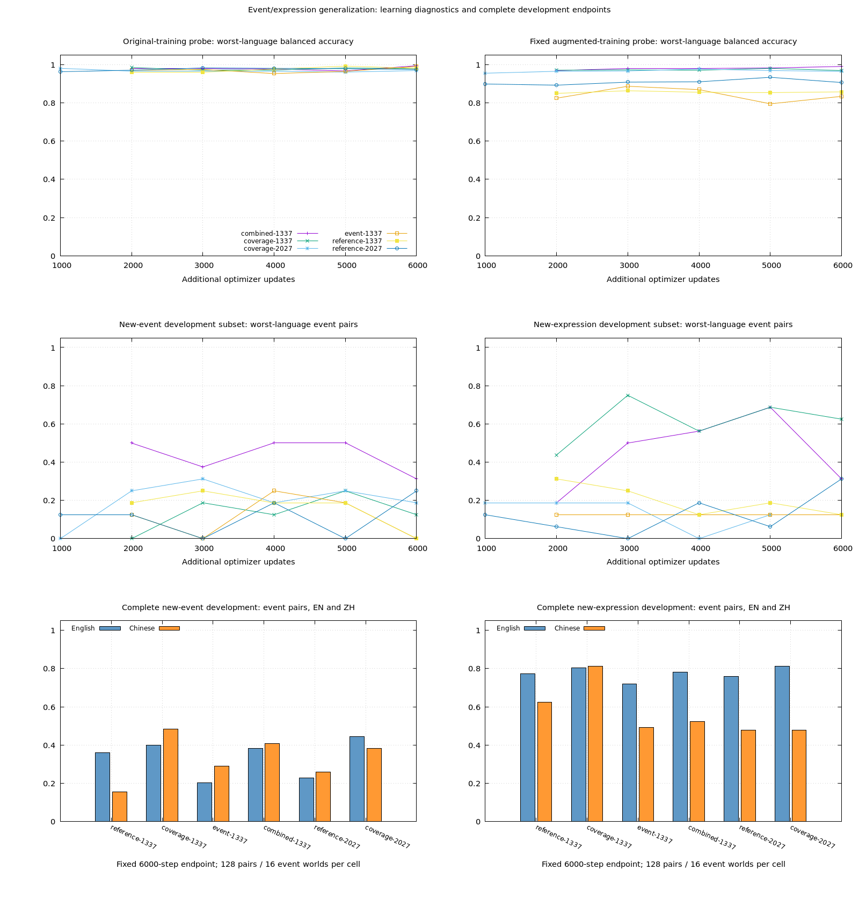
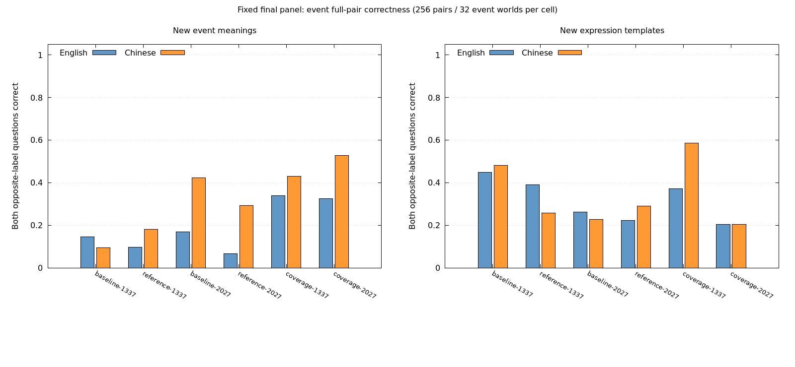

# Decision v0.8 — fresh worlds, event binding and expression transfer

Status: **completed, 2026-10-20**. The [prospective plan](v08-plan.md) tests whether the successful own-model v0.7 actor-binding recipe transfers to fresh panels and benefits from event/expression coverage and an event-pair objective. Six fixed training endpoints, final-panel evaluation, independent audits and the registered template diagnostic finish within **36,175 actual CUDA updates**. The delivered preview remains v0.1.

**Result: partial event-generalization progress, unresolved expression stability.** Coverage improves final new-event full pairs at both seeds/languages, but fails the complete second-seed development confirmation and loses expression pairs on several final cells. A same-world template swap exposes substantial actor-binding fragility. Read the [fixed final results](#fixed-final-panel-event-gains-expression-regressions), [template diagnostic](#paired-template-diagnostic) and [machine-readable evidence](v08-results.json); this is neither an architecture-impossibility result nor a confirmed general factual model.

The [isolation correction](v08-isolation-correction.md) retires the first draft after actual augmentation replay exposes cross-template family overlap. The corrected root is `runs/decision/event-generalization-v08-corrected/`. Original draft predictions are retained but are not final fresh-panel evidence. Corrected preparation excludes actual parent/prefix augmented families, rejects every frozen rendering of reserved worlds and permits only audited prefix migration.

## Frozen data and interpretation

The new development panel contains **10,240 binary rows** and the separately reserved final panel **20,480**, across English/Chinese and five views: new combinations, new actors, new events, new expressions and a composed shift. Each development view has 32 worlds per language; the final view has 64. Worlds balance actor and event axes, with four truth assignments, positive/negative claims and both record orders. Consequently each axis has **128 development / 256 final mixed-truth full pairs per language/view**, sharing only **16 / 32 worlds**. Pair counts are not independent-world sample sizes.

This corrects the initial planning pair denominator before predictions: including both record orders doubles the pairs, while the intended world and row allocations stay unchanged. Both orders remain in the same split and family.

Eight new event meanings are reserved for augmentation, eight different meanings for development-only event tests and eight more for the final event tests. Expression transfer uses trained legacy event meanings with separate development/final wording templates. Neither a new event ID nor a question-prefix change alone establishes general natural-language understanding; this is a controlled synthetic catalog. The composed view changes identities, event meanings and wording together and remains a reported stress diagnostic.

Corrected preparation excludes exact and normalized material overlap with **375,140 historical/replayed local record materials**, excludes unordered actor/event world-family overlap across all new panels, historical structured families and 50,946 actual augmented families, and checks that held-out names do not occur in historical structured fact metadata. This does not establish that every name fragment or event concept was absent from broad parent/tokenizer training. Labels and world metadata support generation/audits only; the model receives text and candidates.

Independent gold fixtures and complete-pair tests cover both languages, fact polarity, query polarity and record order. Current maximum frozen inputs are **58 state tokens / 39 question-option tokens**, with zero truncation. Training retains the parent caps of 256 / 128 and rejects truncation. Full-cap CUDA probes use 256 / 128, microbatch 16 and two-way accumulation under a 4,096 MiB per-process budget.

## Matched experimental comparison

All arms keep the 6,627,841-parameter separate/RoPE model, own tokenizer, person renaming and `.5` actor-pair loss. They initialize from the exact corresponding v0.7 combined endpoint, with identical fresh AdamW state, LR .0003 and no warmup/dropout. A fresh optimizer is a declared new stage, not an exact continuation of the old optimizer trajectory.

Four primary arms each complete 6,000 additional updates at seed 1337: the unchanged-recipe continuation reference, event/expression coverage, event loss, and both interventions. Coverage changes one of the two complete sampled units in each language/axis bucket using only training event/form pools. It preserves the original sampler and labels. Original-row visits must match across all arms; rendered event/template counts and unique state surfaces are reported separately. Equal steps/visits are not equal convergence or FLOPs.

The new event objective reuses the tested opposite-label pair loss, selecting only event-axis rows and aligning candidate IDs after permutation. It adds `.5 * softplus(1 - (z_supported - z_contradicted))`, where `z = logit_yes - logit_no`. CE and the existing actor term remain. Separate loss components, gradient norms and clipping distinguish faster training fit from improved transfer; pairing and relative example weighting are not isolated causal mechanisms.

Augmentation preserves the complete four-query binding/question-polarity unit. Different units can receive different event/form mappings, so inherited cross-unit `fact_flip` IDs refer to original-row bookkeeping rather than a new semantic counterfactual family. Augmented-probe fact-flip aggregate fields must not be interpreted as a fact-flip transfer score; the objective and directional analysis use CE, actor/event binding and row accuracy. Fresh development/final worlds retain complete semantic counterfactual families before all renderings.

Selection requires a five-point improvement in the minimum event-pair score across new-event/new-expression development and both languages, with the planned balanced-accuracy and actor-retention guards. A qualifying candidate and its matching continuation reference repeat at seed 2027. Fixed training/probe diagnostics do not stop the fixed comparison merely because a retention threshold is missed. All partial gains and failures remain recorded.

The final panel is opened only after the selection and conditional confirmation checkpoints are fixed. The comparison includes original v0.7 baselines as well as the matched continuation references, so improvement from extra optimization is visible separately. A failed second-seed confirmation does not authorize changing the candidate before final evaluation. No optimization is permitted after opening.

## Reproduction and local evidence

Entrypoint: `benchmarks/decision/event_generalization.rb`; namespace `DecisionEventGeneralization`. Corrected artifacts are under ignored `runs/decision/event-generalization-v08-corrected/`; the retired draft remains under `runs/decision/event-generalization-v08/`. Frozen protocol/data/catalog/source snapshots, historical material hashes, feasibility checkpoints, per-arm process logs, optimizer traces and failure records are preserved. The final choices and panel-opening marker have integrity sidecars. The orchestration script validates actual checkpoint batch layout after each memory probe; file locks prevent concurrent training into one arm.

```bash
export OMP_NUM_THREADS=1 MKL_NUM_THREADS=1
bundle exec ruby -Itest test/easy_ai/decision/event_generalization_test.rb
bundle exec ruby benchmarks/decision/event_generalization.rb --phase replay --source runs/decision/event-generalization-v08-corrected --output runs/decision/event-generalization-v08-replay
bundle exec ruby benchmarks/decision/event_generalization.rb --phase import_prefixes --output runs/decision/event-generalization-v08-replay
# Repeat for reference, coverage, event, combined:
bundle exec ruby benchmarks/decision/event_generalization.rb --phase preflight --variant reference --output runs/decision/event-generalization-v08-replay
# Both seed baselines must finish before training:
bundle exec ruby benchmarks/decision/event_generalization.rb --phase baseline --seed 1337 --output runs/decision/event-generalization-v08-replay
bundle exec ruby benchmarks/decision/event_generalization.rb --phase baseline --seed 2027 --output runs/decision/event-generalization-v08-replay
bundle exec ruby benchmarks/decision/event_generalization.rb --phase train --variant reference --seed 1337 --output runs/decision/event-generalization-v08-replay
```

Replay requires the retained local v0.7 parents, corrected preparation and retired-draft prefix/audit artifacts. It copies the already observed frozen panels rather than pretending to reserve their names again, and imports the audited 1,500-step prefixes. The replay marker explicitly removes any new-independent-panel interpretation. Finish all four arms before `--phase select`. If improving, run `reference` and the selected variant at seed 2027; otherwise do no unregistered extra search. Then `--phase finalize_choices`, `--phase lockbox`, and audits for each evaluated identity/split. `--phase report` requires completed final evaluations and audits; `--phase plot` displays fixed learning curves. Include the replay root on every command.

The hard ceiling is **37,000 actual experiment CUDA updates**, including probes and replay, with at most 36,000 main updates. CPU tests assert logic and exact resume rather than stochastic convergence. Full GPU final predictions independently reconstruct actor/event pairs; CPU/CUDA and public candidate-order audits use the fixed first four complete worlds per language/view (256 rows), and explicitly report this subset scope. Broad natural QA, unknown handling, calibrated factual confidence, a model-size sweep and a new release are outside this round.

## Retired draft probes and baselines — not final fresh-panel evidence

All four full-cap 256/128-token CUDA probes complete three actual updates at micro16/accumulation2. Each samples **1,778–1,810 MiB** process memory, below the 4,096 MiB soft budget. The controller independently reads checkpoint metadata to confirm the actual layout. These probes contribute 12 updates to the experiment ledger.

Both original v0.7 combined checkpoints finish fresh-development inference before v0.8 training. Baseline event full-pair correctness is:

| Development view | Seed 1337 EN / ZH | Seed 2027 EN / ZH |
| --- | ---: | ---: |
| New combinations | 89.844% / 82.031% | 97.656% / 95.313% |
| New actors | 78.906% / 85.156% | 92.188% / 96.094% |
| New events | 30.469% / 16.406% | 26.563% / 23.438% |
| New expressions | 64.063% / 82.031% | 79.688% / 67.969% |
| Composed shift | 4.688% / 13.281% | 12.500% / 16.406% |

Each cell has 128 event pairs sharing 16 event worlds. New-event balanced row accuracy is 79.883% / 84.668% at seed 1337 and 85.156% / 88.281% at seed 2027; these much higher aggregate scores do not erase weak event binding. The minimum event-pair score on the two primary views is 16.406% / 23.438% for the original seeds. The final intervention criterion compares candidates to their **matched v0.8 continuation reference**, not just these original checkpoints.

These are observations on the retired draft, preserved to explain the investigation. They must not be used to select or claim fresh transfer in the corrected run. The draft final panel has no predictions; corrected baselines and final results are recorded separately after their own frozen preparation.

## Corrected original-checkpoint baselines

The replacement panel is evaluated with the same two original v0.7 combined checkpoints before continuing the audited prefixes. These are fresh world-family tests relative to the replayed training histories, with the post-start isolation repair disclosed above.

| Development view | Seed 1337 event pairs EN / ZH | Seed 2027 event pairs EN / ZH |
| --- | ---: | ---: |
| New combinations | 58.594% / 75.781% | 61.719% / 71.094% |
| New actors | 71.094% / 81.250% | 94.531% / 86.719% |
| New events | 12.500% / 22.656% | 32.031% / 36.719% |
| New expressions | 74.219% / 71.875% | 68.750% / 60.938% |
| Composed shift | 7.031% / 15.625% | 11.719% / 20.313% |

All cells contain 128 event pairs sharing 16 worlds. Original new-event balanced row accuracy is 78.027% / 86.328% and 87.402% / 87.695% for the two seeds, again much higher than full-pair correctness. The replacement panel is intentionally not interchangeable with the retired draft; no favorable score is substituted between them.

## Completed primary factorial, seed 1337

| Recipe | New-event full pairs EN / ZH | New-expression full pairs EN / ZH | Minimum target event cell | Direction criterion |
| --- | ---: | ---: | ---: | --- |
| Continuation reference | 35.938% / 15.625% | 77.344% / 62.500% | 15.625% | Reference |
| Coverage | 39.844% / 48.438% | 80.469% / 81.250% | **39.844%** | Pass, selected |
| Event loss | 20.313% / 28.906% | 71.875% / 49.219% | 20.313% | Fail |
| Combined | 38.281% / 40.625% | 78.125% / 52.344% | 38.281% | Pass |

Coverage and combined both clear the frozen directional and retention guards; coverage wins by the primary minimum, **24.219 percentage points** above the matched reference. It retains v0.7 person renaming and actor-pair loss; “coverage” does not mean CE alone. Adding the new event auxiliary term is not necessary for this winning recipe. The event-only arm has meaningful regressions, including English new-event pairs and Chinese expression pairs, rather than merely missing an arbitrary near-threshold target.

Coverage's new-event balanced accuracy is **85.156% EN / 88.672% ZH**, versus 76.563% / 86.523% for the reference. Its new-expression balanced accuracy is 96.777% / 95.605%, versus 95.313% / 93.457%. New-actor full pairs also improve from 47.656% / 33.594% to 59.375% / 43.750%. Full original-training balanced accuracy is 98.877% / 98.389%, with actor pairs 93.555% / 91.211% and event pairs 97.656% / 96.289%; complete training fit and unseen transfer remain separate measurements.

The composed stress view remains weak despite gains: coverage event pairs are 32.031% / 27.344% versus reference 15.625% / 15.625%, while actor pairs are 46.094% / 28.906%. Combined is stronger on some composed actor cells despite losing the declared selection. All four results are retained; no single method wins every slice.

Original-row visits match across all four arms. Reference/event also have exactly equal rendering histories, as do coverage/combined, checked at both the inherited 1,500 and final 6,000 checkpoints. Every final primary rendering history has zero overlap with the strengthened reserved-state set. Actual input auditing covers **43,520 frozen rows**, with **zero opposite-label tokenized-input collisions and zero truncation**; both parent tokenizers share one fingerprint.

## Second-seed confirmation: partial gain, full criterion fails

Both seed-2027 arms finish their fixed 6,000 updates. The candidate remains coverage; no alternative is selected after confirmation.

| Recipe | New-event pairs EN / ZH | New-expression pairs EN / ZH | Minimum target event cell |
| --- | ---: | ---: | ---: |
| Continuation reference | 22.656% / 25.781% | 75.781% / 47.656% | 22.656% |
| Coverage | 44.531% / 38.281% | 81.250% / 47.656% | 38.281% |

The target minimum improves by **15.625 percentage points**, and new-event balanced accuracy improves from 85.254% / 89.355% to 91.406% / 90.527%. However, Chinese expression balanced accuracy falls from **91.016% to 87.402%**, a **3.613-point** regression exceeding the frozen three-point guard. Consequently **confirmation fails**. This is partial event-transfer evidence at both seeds, not a repeated pass of the complete criterion. English expression balanced accuracy is 95.020% → 94.727%; new-actor full pairs improve from 25.781% / 32.813% to 44.531% / 46.875%.

Final choices are sealed before opening the reserved panel at **2026-10-20 09:04:59 UTC**. Both original parents, both matched references and both fixed coverage endpoints are evaluated despite the unfavorable confirmation. No optimization or reselection follows the opening.

One expression-coverage limitation is explicit: the fixed generator pairs development actor/event worlds with forms 3/4 respectively, and final actor/event worlds with forms 5/6. The primary event-expression metric therefore tests one held form per axis, not a balanced cross of both forms. Before final opening, a sealed **post-selection paired-template diagnostic** was registered to swap forms 5/6 on the unchanged final expression/composed families for every fixed checkpoint. It adds no training, threshold change, model selection or independent worlds. Original and crossed results are reported separately. Its controller finishes after the planned final evaluations/audits and refreshes the report without altering the frozen primary protocol.

Use `--phase audit_inputs` to reproduce the cached tokenizer/collator integrity certificate and `--phase crossed_templates` for the registered fixed-weight paired-template diagnostic after final-panel opening. Data/target preservation and involution of the swap are deterministic unit tests. The final report also checks saved public probabilities against same-device batched labels; normalized probabilities alone are not semantic correctness.



The upper learning curves are diagnostics. Each development-subset curve has only two event worlds per language; complete endpoint bars and the table use 16 event worlds / 128 pairs per language/view. Subset peaks and minima are not selection criteria. Primary curves begin after the isolation correction; retired-draft development points are not mixed into these curves.

## Fixed final panel: event gains, expression regressions

All six preselected checkpoints finish the same final panel. Each cell below is full-pair correctness on **256 pairs / 32 event worlds**; rows within one world share facts, wording and truth assignments. The two seeds use the same evaluation panel, so seed replication is not a second independent dataset.

| Fixed checkpoint | New-event pairs EN / ZH | New-expression pairs EN / ZH |
| --- | ---: | ---: |
| Original v0.7, seed 1337 | 14.453% / 9.375% | 44.922% / 48.047% |
| Continuation reference, seed 1337 | 9.766% / 17.969% | 39.062% / 25.781% |
| Coverage, seed 1337 | **33.984% / 42.969%** | 37.109% / 58.594% |
| Original v0.7, seed 2027 | 16.797% / 42.188% | 26.172% / 22.656% |
| Continuation reference, seed 2027 | 6.641% / 29.297% | 22.266% / 28.906% |
| Coverage, seed 2027 | **32.422% / 52.734%** | 20.312% / 20.312% |

Coverage improves new-event full pairs over the matching reference at both seeds and languages, and also beats both original parents on those cells. Extra continuation alone does not explain these gains. However, English expression pairs decline at both seeds, and Chinese expression pairs decline at seed 2027. Neither the new-event score nor a high row score establishes dependable relational understanding.

| Fixed checkpoint | New-event balanced EN / ZH | New-expression balanced EN / ZH | Composed actor pairs EN / ZH | Composed event pairs EN / ZH |
| --- | ---: | ---: | ---: | ---: |
| Reference 1337 | 68.799% / 82.324% | 87.402% / 73.779% | 15.234% / 32.812% | 14.062% / 12.109% |
| Coverage 1337 | 87.354% / 84.521% | 87.012% / 91.113% | 33.594% / 25.781% | 18.359% / 30.078% |
| Reference 2027 | 83.105% / 87.939% | 81.641% / 83.301% | 19.141% / 12.891% | 2.344% / 18.359% |
| Coverage 2027 | 88.770% / 91.943% | 82.812% / 83.887% | 27.734% / 27.734% | 18.750% / 45.312% |

Applying the unchanged directional rule to these fixed final views plus old regressions returns true at both seeds. That rule guards balanced accuracy and the minimum target event cell; it does **not** require every expression-pair cell to improve. It does not reverse the failed development confirmation or justify changing the rule after opening. The defensible outcome is **partial, repeated new-event progress with unresolved expression and composed-shift failures**, rather than a full confirmed generalization recipe.



### Paired errors and remaining failures

Compare the same final new-event questions before/after coverage. “Corrected” and “lost” refer to whole opposite-label pairs, not individual rows; world counts aggregate their net change.

| Seed / language | Corrected pairs | Lost pairs | Worlds improved / worsened / tied |
| --- | ---: | ---: | ---: |
| 1337 / EN | 76 | 14 | 19 / 5 / 8 |
| 1337 / ZH | 82 | 18 | 24 / 2 / 6 |
| 2027 / EN | 75 | 9 | 19 / 5 / 8 |
| 2027 / ZH | 89 | 29 | 21 / 9 / 2 |

There are 256 pairs and 32 worlds in each row, rather than 256 independent observations. Expression regressions are real too: at seed 2027, Chinese expressions gain 25 pairs and lose 47, with 5 worlds improving and 18 worsening. The machine-readable [complete results](v08-results.json) retain every view, both axes, counts, fixed first remaining errors and audit records.

One deterministic first remaining seed-1337 English failure says `Finley Gray did not mend the fence. Finley Gray peeled the orange.` The two positive claims about mending and peeling should receive `no / yes`; both reference and coverage answer `yes / yes`. A Chinese failure says `韩文没有洗杯子。韩文烧开了水。`; the two negative claims should receive `yes / no`, yet both answer `yes / yes`. These are opposite-label errors within one unchanged record, not an accuracy/error-rate inversion. Independent random binary guesses have 25% expected full-pair correctness; correlated identical answers can score zero on a pair even with one correct row.

### Paired-template diagnostic

All six fixed checkpoints complete the registered zero-training swap on the final expression/composed families. The expression results below compare the **same worlds and targets**, with actor form 5 → 6 and event form 6 → 5. Each axis/language still has 256 pairs sharing 32 worlds; these are paired measurements, not additional independent samples.

| Fixed checkpoint | Original actor pairs EN / ZH | Crossed actor pairs EN / ZH | Original event pairs EN / ZH | Crossed event pairs EN / ZH |
| --- | ---: | ---: | ---: | ---: |
| Reference 1337 | 78.125% / 67.578% | 18.750% / 20.312% | 39.062% / 25.781% | 58.203% / 48.828% |
| Coverage 1337 | 78.906% / 82.031% | **20.312% / 41.797%** | 37.109% / 58.594% | 70.312% / 78.516% |
| Reference 2027 | 86.719% / 78.516% | 22.266% / 23.438% | 22.266% / 28.906% | 60.547% / 58.984% |
| Coverage 2027 | 90.234% / 86.719% | **15.625% / 28.516%** | 20.312% / 20.312% | 57.422% / 68.750% |

Changing the template strongly changes binding despite unchanged semantic facts. Coverage retains some advantages over the reference but does not solve this brittleness; the original strong actor score depends heavily on which held template is used. Crossed event scores being higher does not offset the actor failures. Both original parents and both composed-view diagnostics are retained in the complete results. The diagnostic's protocol/selection/source hashes and pre-opening registration are verified, as are all raw prediction hashes and fixed checkpoint identities. It causes no reselection or further training.

## Completion scope and next useful experiments

The experiment performs **36,175 actual CUDA updates**: 36,000 main updates, 151 exact replay updates and 24 feasibility updates, below the 37,000 ceiling. All six main endpoints have exactly 6,000 updates. No training follows final opening; failed arms, the unfavorable confirmation, retired draft and isolation repair remain preserved. The original source archive verifies against its manifest.

Event/expression coverage is a package: this factorial does not isolate new event meanings from new wording. A useful separately authorized follow-up would cross templates independently with actor/event axes, separate event coverage from expression coverage, and test retention of older forms with matched exposure. Existing v0.8 development/final worlds are now observed regression data; new selection or acceptance needs newly reserved families and renderings. Further data/model scaling is not established as the remedy for the identified expression failures.

Natural QA/NLI, missing-information handling, probability calibration and release readiness are untested here. v0.1 remains the delivered request-domain preview. Diagnostic coverage weights can be loaded with `EasyAI::Decision::Predictor.load("runs/decision/event-generalization-v08-corrected/arms/coverage-1337/choice", device: "auto")`; seed 2027 is retained alongside it. These checkpoints do not constitute a general factual release or Jev parity.

## Deterministic verification

The full suite passes **285 tests / 7,067 assertions**, including **10 / 553** for this round. Learning passes **81 / 327**, and RuboCop inspects **404 files** without offenses. The new tests check hand-derived bilingual gold labels, record and candidate permutations, event-loss gradients and axis isolation, whole-unit augmentation, reserved-family rejection, reference equivalence, exact optimizer resume, guarded prefix migration, selection thresholds, artifact integrity and template-swap target preservation. They assert mathematical and control-flow correctness, rather than stochastic training quality.

GPU evidence remains separate: full frozen predictions reconstruct both binding axes independently; **all 70 fixed development/final view audits have zero CPU/CUDA classification differences**, and public probabilities agree with same-device batched predictions under candidate-order/chunk checks. These audits cover 17,920 fixed rows on each device, rather than the entire panels on CPU. Tokenizer/collator auditing checks the actual saved vocabulary and caps. The course site builds and verifies **17 chapters / 5,186 local links and assets**; changed repository Markdown links resolve. Passing these checks does not turn weak semantic scores into a successful result.
