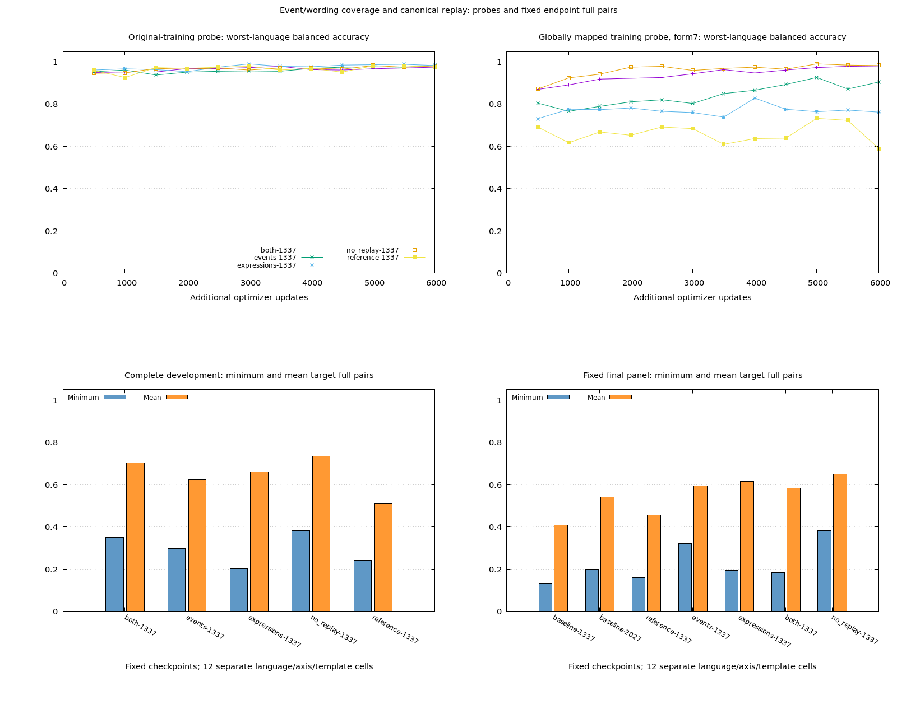
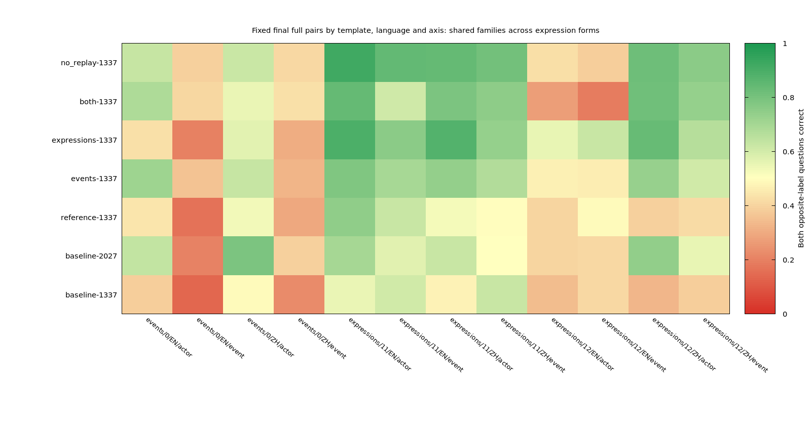
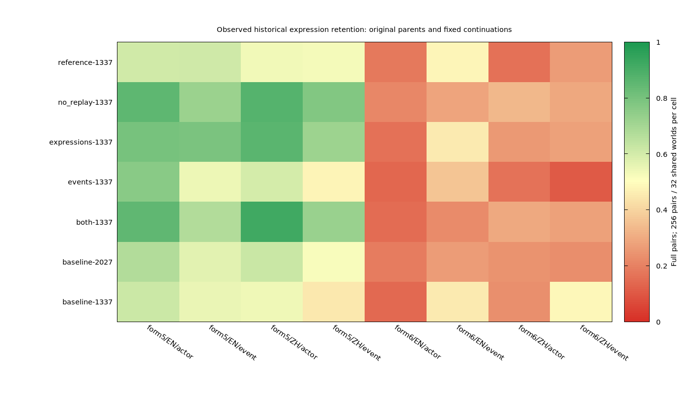

# Decision v0.9 — independent event/wording coverage and retention

Status: **completed 2026-10-20 — partial transfer gains; no complete retention/robustness pass**. The [prospective protocol](v09-plan.md) separates event coverage from expression coverage, crosses every held expression with both binding axes and compares fixed canonical-form replay. All arms use the own 6.63M v0.7 combined parents; v0.8 is observed regression. v0.1 remains delivered.

Implementation: `benchmarks/decision/expression_retention.rb`, namespace `DecisionExpressionRetention`; local artifacts: `runs/decision/expression-retention-v09/`. Five primary arms each run 6,000 updates; only a qualifying selected recipe and its matched reference would trigger seed-2027 confirmation. None qualifies. All original parents and primary endpoints enter the fixed final comparison. Actual total: **30,015 CUDA optimizer updates**, including 15 probes and no replayed updates, below the planned maximum of 42,015 and hard ceiling of 43,000. No optimization follows final opening.

Core deterministic tests pass **12 tests / 443 assertions**, including hand gold under all 13 templates, same-family cross-form allocation, complete-unit independent interventions and replay fractions, per-template metrics, numerical reference equivalence, exact optimizer resume, canonical-family exclusion and selection/integrity guards. Training quality is measured separately, not asserted by tests.

Scientific sources, data, parent weights, tokenizer, exclusions and the plan are frozen before model predictions. Only read-only presentation/audit/reporting may evolve, with final hashes recorded. All failures are retained. Preserve the committed v0.8 sources and artifacts.

```bash
export OMP_NUM_THREADS=1 MKL_NUM_THREADS=1
bundle exec ruby -Itest test/easy_ai/decision/expression_retention_test.rb
bundle exec ruby -Itest test/easy_ai/decision/expression_retention_policy_test.rb
bundle exec ruby benchmarks/decision/expression_retention.rb --phase prepare
# Repeat for reference, events, expressions, both, no_replay:
bundle exec ruby benchmarks/decision/expression_retention.rb --phase preflight --variant reference
bundle exec ruby benchmarks/decision/expression_retention.rb --phase baseline --seed 1337
bundle exec ruby benchmarks/decision/expression_retention.rb --phase baseline --seed 2027
bundle exec ruby benchmarks/decision/expression_retention.rb --phase train --variant reference --seed 1337
```

Complete all five primary arms before `--phase select`. If eligible, run only reference and the selected arm at seed 2027. Then `--phase finalize_choices`, `--phase lockbox`, audits for all evaluated identities/splits, `--phase report`, and `--phase plot`. Do not rerun preparation into a frozen root. A later `--phase replay --source runs/decision/expression-retention-v09 --output runs/decision/expression-retention-v09-replay` copies observed panels for reproduction, not new independent acceptance; include the output root on every subsequent command. Local parent checkpoints and frozen artifacts must be retained or recovered separately.

Full checks pass **297 tests / 7,510 assertions**, learning **81/327**, RuboCop **413 files clean**. Data integrity covers **81,920 frozen rows / 80,896 unique tokenized inputs**, zero opposite-label collisions/truncation, maxima 59/48. All 191 initial source snapshots verify. All five full-cap probes use 1,778–1,810 MiB, below the 4,096 MiB per-process budget. Original parent development baselines are saved before primary training. Seven fixed final checkpoints were sealed before the one-time final opening at 2026-10-20 12:02 UTC. Only read-only presentation/audit/report code is completed after freezing, with the initial archive preserved and its final helper hash recorded.

## Original-parent development baseline

These are the two unchanged v0.7 parent checkpoints on the new development panel, measured before v0.9 training. Every cell has 128 mixed pairs sharing 16 worlds. Both expression forms render the same worlds; their scores are paired measurements, not additional independent families.

| View / form / axis | Seed 1337 EN / ZH | Seed 2027 EN / ZH |
| --- | ---: | ---: |
| New events / 0 /actor | 33.594% / 44.531% | 82.813% / 53.125% |
| New events / 0 /event | 29.688% / 8.594% | 22.656% / 35.156% |
| New expressions / 9 /actor | 55.469% / 35.938% | 75.000% / 63.281% |
| New expressions / 9 /event | 42.969% / 32.813% | 53.906% / 53.906% |
| New expressions / 10 /actor | 69.531% / 53.906% | 75.781% / 76.563% |
| New expressions / 10 /event | 55.469% / 46.875% | 51.563% / 64.063% |

Do not compare these percentages as a common benchmark trend with v0.8: the event meanings, wording and world allocations differ. Matched continuation references provide the comparison for this round.

## Complete primary development comparison

All five primary arms finish 6,000 CUDA updates at seed 1337. The table summarizes the **same 12 target cells**, rather than averaging actor and event questions into one row score. The first four arms separate event and wording coverage; `no_replay` exchanges the remaining canonical-form exposure for additional new wording. See the [frozen protocol](v09-plan.md) for the complete exposure recipe.

| Arm | Minimum target full pairs | Mean of 12 cells | Frozen development qualification |
| --- | ---: | ---: | --- |
| reference | 24.219% | 50.846% | Matched continuation control |
| events | 29.688% | 62.240% | Fails basic Chinese combination and historical retention guards |
| expressions | 20.313% | 66.081% | Fails minimum improvement, new-event and historical-event retention |
| both | 35.156% | 70.247% | Fails one new-expression event cell and historical-event retention |
| no_replay | 38.281% | 73.372% | Fails historical English novel-actor retention |

`no_replay` passes the minimum-gain, every target-pair and every basic balanced-accuracy requirement. Its sole failing aggregate guard is old English novel-actor full pairs: **61.328% → 55.078%**, a 6.25-point decrease relative to the matched reference. The original parent's score on that same old cell is 46.875%, so this particular failure is foregone continuation gain rather than an absolute loss from the parent. This does not erase other per-form weaknesses or establish robustness. The result is useful partial progress despite failing the complete declared criterion; the five-point guard is not a physical boundary between a viable and impossible model.

`both` improves the target minimum by 10.938 points and the mean by 19.401 points. Its English new-expression/form 10 event cell declines by 5.469 points, just beyond the individual-cell guard. That near-boundary miss is not its only limitation: old Chinese combination/event pairs lose 8.203 points and old English expression/event pairs lose 9.766 points relative to reference. No arm qualifies, so the protocol skips the conditional seed-2027 continuation. Both unchanged original parents and all five primary endpoints remain in the fixed final comparison. No recipe is reselected after final opening.

These primary intervention effects have only one training seed. The second unchanged parent is a baseline, not an independent replication of an intervention. Development and final expression templates differ; their numeric scores must be reported separately.

| Development target cell | Reference | Events | Expressions | Both | No replay |
| --- | ---: | ---: | ---: | ---: | ---: |
| events / 0 / en-US / actor | 46.094% | 57.812% | 37.500% | 67.188% | 65.625% |
| events / 0 / en-US / event | 29.688% | 47.656% | 25.000% | 39.844% | 46.875% |
| events / 0 / zh-CN / actor | 50.000% | 57.812% | 50.781% | 60.156% | 66.406% |
| events / 0 / zh-CN / event | 24.219% | 29.688% | 20.312% | 35.156% | 38.281% |
| expressions / 9 / en-US / actor | 50.781% | 82.031% | 86.719% | 97.656% | 91.406% |
| expressions / 9 / en-US / event | 43.750% | 67.969% | 67.969% | 57.812% | 72.656% |
| expressions / 9 / zh-CN / actor | 53.906% | 74.219% | 90.625% | 82.812% | 86.719% |
| expressions / 9 / zh-CN / event | 53.906% | 62.500% | 70.312% | 75.000% | 75.000% |
| expressions / 10 / en-US / actor | 74.219% | 78.125% | 89.844% | 96.094% | 97.656% |
| expressions / 10 / en-US / event | 57.812% | 56.250% | 79.688% | 52.344% | 86.719% |
| expressions / 10 / zh-CN / actor | 67.969% | 70.312% | 92.969% | 93.750% | 85.156% |
| expressions / 10 / zh-CN / event | 57.812% | 62.500% | 81.250% | 85.156% | 67.969% |

## Fixed final evaluation: useful gains, unresolved wording transfer

| Fixed final checkpoint | Minimum of 12 target cells | Mean of 12 cells |
| --- | ---: | ---: |
| baseline-1337 | 13.281% | 40.951% |
| baseline-2027 | 19.922% | 54.004% |
| reference-1337 | 16.016% | 45.703% |
| events-1337 | 32.031% | 59.440% |
| expressions-1337 | 19.531% | 61.654% |
| both-1337 | 18.359% | 58.464% |
| no_replay-1337 | 38.281% | 65.072% |

The final comparison includes all five primary endpoints and both unchanged parents, fixed before final predictions. No primary arm qualified, so there is no selected/confirmed winner and no seed-2027 intervention replication. The final panel is a fixed comparison, not an opportunity to choose another recipe.

`no_replay` raises the minimum of the 12 final target cells from **16.016% to 38.281%**, and their mean from **45.703% to 65.072%**, relative to matched continuation. Final new-event/event full pairs improve from **41/256 → 99/256 English (16.016% → 38.672%)** and **74/256 → 104/256 Chinese (28.906% → 40.625%)**. Each cell shares only 32 worlds. These are meaningful gains at fixed model size; most difficult pairs are still unsolved.

Wording transfer remains uneven. English final-expression/event pairs improve on form 11 from 62.109% to 83.984%, but decline on form 12 from **48.828% to 38.281%**. Its final English novel-actor balanced accuracy also loses 3.369 points, and the old English actor guard still fails. The same frozen directional rule therefore fails on the fixed final comparison as well. `both` has a much larger English form 12 event regression, **48.828% → 18.359%**, despite gains in new events and Chinese expressions. Canonical-form replay does not guarantee structural expression retention. No other arm satisfies the complete final directional rule, including historical retention.

| Final target cell | Reference | Both | No replay |
| --- | ---: | ---: | ---: |
| events / 0 / en-US / actor | 43.750% | 67.578% | 62.500% |
| events / 0 / en-US / event | 16.016% | 40.234% | 38.672% |
| events / 0 / zh-CN / actor | 52.734% | 54.688% | 61.719% |
| events / 0 / zh-CN / event | 28.906% | 42.578% | 40.625% |
| expressions / 11 / en-US / actor | 74.219% | 83.594% | 91.797% |
| expressions / 11 / en-US / event | 62.109% | 60.547% | 83.984% |
| expressions / 11 / zh-CN / actor | 52.344% | 78.516% | 83.594% |
| expressions / 11 / zh-CN / event | 49.609% | 74.609% | 80.469% |
| expressions / 12 / en-US / actor | 39.844% | 26.562% | 42.188% |
| expressions / 12 / en-US / event | 48.828% | 18.359% | 38.281% |
| expressions / 12 / zh-CN / actor | 38.672% | 81.250% | 81.641% |
| expressions / 12 / zh-CN / event | 41.406% | 73.047% | 75.391% |





Paired errors for `reference → no_replay` distinguish gains from replacement errors:

| Final event-binding cell | Corrected pairs | Lost pairs | Worlds improved / worsened / tied |
| --- | ---: | ---: | ---: |
| New events / EN / form 0 | 70 | 12 | 22/1/9 |
| New events / ZH / form 0 | 58 | 28 | 17/8/7 |
| New expressions / EN / form 11 | 64 | 8 | 16/0/16 |
| New expressions / EN / form 12 | 31 | 58 | 9/16/7 |
| New expressions / ZH / form 11 | 96 | 17 | 20/4/8 |
| New expressions / ZH / form 12 | 114 | 27 | 23/4/5 |

Each row has 256 mixed-truth pairs over 32 worlds. Opposite-label questions must both be correct. The two expression forms share worlds; their rows cannot be counted as independent family replications. Independent random binary answers have 25% expected full-pair correctness; always answering `yes` obtains 50% mixed-row accuracy and zero full pairs. World changes and remaining concrete failures are retained in [the machine-readable results](v09-results.json), together with every arm, template and binding axis.

The round supports **partial progress with a bounded negative retention/robustness result**. Event exposure helps new-event transfer; wording exposure helps several explicit-framing cells. Neither the canonical replay recipe nor its removal establishes stable understanding across state structures. A narrowly missed development guard is not evidence of architectural impossibility; the independent form 12 and historical form 6 failures are substantive limits beyond that one threshold. Training-seed replication and broader natural language remain unproven.

## Input-path integrity and limitations

All 8,192 actual original training rows render identically under canonical form 0. A saved-checkpoint CPU-only RNG replay at 1,000 updates reproduces every original row visit, actual family/state set and event/axis/form frequency for the first four arms. Source: the read-only `DecisionExpressionRetention.audit_data_paths` helper in `presentation.rb`; evidence `data-path-replay-1000-1337.json` in the local root. No model forward or optimizer update is involved.

Old exact-state exclusions can reject a canonical state while allowing a different wording of the same **nonreserved** family. This changes subsequent name draws within a batch. At 1,000 updates, reference/expressions have different canonical families in **46 of 8,000 units (0.575%)**; events/both have **zero** different renamed units. Original row visits and matched event exposure remain identical. The former comparison therefore includes a small name-exposure difference and is not a perfectly isolated wording-only causal estimate. Reserved-family checks remain active for every form; no new evaluation family is permitted. Preserve this limitation and the replay evidence rather than change the frozen intervention after observing development.

The completed **6,000-step replay verifies all five actual checkpoint histories**, including every row visit, family/state set and event/axis/form frequency. Among 48,000 units per arm, canonical families differ in **307 units (0.640%)** for reference/expressions, **zero** for events/both, and **545 units (1.135%)** for both/no_replay. The replay tradeoff therefore also includes a small name-exposure difference. Family-rejection counts are 218/103/217/103/104; inherited exact-state rejections are 560/263/263/263/0 (reference/events/expressions/both/no_replay). These are executed training-path checks, not assertions about model quality. No reserved-family or reserved normalized-state overlap is observed. Evidence: `data-path-replay-6000-1337.json`.

For reproduction after all primary checkpoints exist, run the full audit without training:

```bash
bundle exec ruby -r ./benchmarks/decision/expression_retention -e 'DecisionExpressionRetention.audit_data_paths(File.expand_path("runs/decision/expression-retention-v09"), steps: 6000, include_no_replay: true)'
```

The new wording catalog mainly varies explicit-fact framing. It does not independently cover every language phenomenon, such as the pronoun construction in historical form 6. Historical regression retains that form on both axes. The frozen old-regression guard uses language/axis aggregates; all its per-form scores remain available and must also be inspected before claiming expression stability. A directional pass does not establish that every historical form improves.

## Supplemental verification and historical diagnostics

Six additional guard tests (27 assertions) use hand-valued counterexamples in which only one qualification rule fails. They check individual target-pair retention independently of minimum improvement, each basic template's balanced accuracy, both old binding axes, old row retention, ranking arithmetic and the composed stress scope. They were added after primary development observations to verify the already frozen policy; no scientific code, threshold or selection rule changed. Their source is separately hashed and copied under `verification-sources/`, preserving all 191 original snapshots.

The exact original v0.7 parents' historical v0.8 regression scores are reconstructed from already saved, verified uncalibrated logits. Both expression/composed forms are crossed on the same worlds. Full state/question/options/target identity and source prediction/weight hashes match the current observed regression data. This adds no inference or optimizer updates, and distinguishes absolute changes from the original parent versus opportunity cost relative to the continuation reference. Cache: `historical-parent-regression.json`.

A separate **post-hoc state/question wording diagnostic** is registered after the first four primary endpoints reveal historical form 6 sensitivity. It evaluates all four combinations of state forms 5/6 and question forms 5/6 on the same old expression families, for both parents and every completed v0.9 endpoint. Diagonal scores reuse verified logits; only the off-diagonal cases require new fixed-weight CUDA inference. Each language/axis cell has 256 pairs sharing 32 worlds. It supplies no new independent acceptance, optimizer updates or v0.9 final predictions, and does not change eligibility. The registration/source snapshot and raw results remain under `historical-wording-*` in the local root.

The `both/ 1337` diagnostic locates a strong state-framing effect: English actor pairs are 84.766% with state 5/question 5 and 84.375% with state 5/question 6, but 14.453% with state 6/question 6 and 15.625% with state 6/question 5. English event pairs show 66.797% / 65.625% versus 21.875% / 21.875% respectively. These compare the same facts at unchanged weights. Form 6 changes several state features together, so the experiment does not isolate pronoun resolution as the cause. Some other arms/languages also show question-framing sensitivity; inspect all cases rather than generalize this one pattern.

All seven historical state/question diagnostics are now saved. `no_replay` also has a large state-form difference: English actor/event pairs are 85.156% / 71.875% with state 5/query 5, versus 21.094% / 28.125% with state 6/query 6. Questions can matter too: in the event-only arm, Chinese state 5 event pairs fall from 47.266% with query 5 to 6.641% with query 6. The two original parents already struggle with form 6 actor binding. Neither canonical replay nor removing it resolves this structural wording sensitivity.



This historical panel is observed regression. Each form/language/axis cell contains 256 pairs sharing 32 worlds; forms 5/6 reuse the same worlds. For `both`, old English form 6 event pairs decline from the original parent's 44.922% to 21.875%; Chinese declines from 48.047% to 27.344%. For `no_replay`, the corresponding values are 28.125% / 28.906%. Gains on form 5 can conceal these losses when forms are pooled. Keep per-form retention in future evaluation even where an aggregate guard passes.

The read-only evaluation scheduler parallelizes different fixed checkpoints and device audits. It temporarily suspends and automatically resumes the sequential reader/parent controller to avoid duplicate writes; saved hashes are verified by the original controller afterward. No optimizer update, model input, gold label, numerical evaluation method, selection rule or fixed model list changes. Scheduling logs are `tmp/decision-v09-fixed-final-parallel.log`, `tmp/decision-v09-development-audit-controller.log`, and `tmp/decision-v09-final-interface-audit-controller.log`.

Completion evidence includes `experimental-phases-finished.json`, `data-path-audit-finished.json`, and `historical-wording-audits-finished.json`. Logs: `tmp/decision-v09-controller.log`, `tmp/decision-v09-final-data-audit-controller.log`, `tmp/decision-v09-historical-wording-controller.log`. No training remains active.

## Device and artifact verification

All **70 fixed development/final view audits** agree on CPU/CUDA classification across **25,088 rows per device**. This is the first four complete worlds per language/view and every held form, not full-panel CPU equivalence. The maximum observed absolute logit difference is 0.000372. Public probabilities match same-device batched predictions under reversed candidate order and chunk size 1; probabilities sum correctly and remain finite. Full CUDA panels independently reconstruct actor/event pairs overall and per form.

The report verifies **95 full prediction files**, the seven fixed final weight identities, all 191 original source snapshots, the complete finite CUDA update ledger, canonical rendering, all seven historical wording diagnostics, historical parent logits, both pure-data replays and supplemental policy-test sources. The three charts are reviewed against the saved numeric results. Full tests pass 297/7,510 assertions, learning 81/327, and lint covers 413 clean files; course build/check verifies 17 chapters and 5,186 local links/assets. Core tests prove mathematical and control-flow correctness rather than training convergence. See [the complete portable record](v09-results.json) for exposure and paired errors.

## Loading and preserving the experiments

The original v0.7 checkpoints, frozen own tokenizer, generated panels, source snapshots and raw predictions live under the ignored local run roots. Commit the compact results and charts; preserve or back up those local roots separately. Do not rerun `prepare` over this frozen experiment. A copied observed panel remains observed evidence, even on another machine.

The diagnostic endpoints can be loaded through the same public API as other choice models:

```ruby
require "easy_ai"

predictor = EasyAI::Decision::Predictor.load(
  "runs/decision/expression-retention-v09/arms/no_replay-1337/choice",
  device: :cuda,
  candidate_chunk_size: 1
)
result = predictor.probabilities(
  state: "Carla pressed the button. Dora did not press the button.",
  question: "Judge this claim against the record: Carla pressed the button.",
  options: [{ id: "yes", text: "Yes" }, { id: "no", text: "No" }]
)
puts result
```

Use `device: :auto` (or `"auto"`) for CUDA with CPU fallback. These experiments explicitly require CUDA and check for fallback; deterministic tests use CPU. Candidate probabilities are uncalibrated scores. This loading example does not promote an endpoint to a factual release or claim it answers the example correctly. v0.1 remains the delivered request-domain preview.

## What the next experiment should resolve

The measured bottleneck is transfer and retention across **state structures**, beyond explicit-fact prefixes. A useful separately authorized next scope would first construct a small, hand-audited bilingual structural contrast set: explicit subjects, topic clauses, unambiguous pronouns and reordered records. Vary state and question forms independently on the same facts and retain both binding axes. Introduce several renderings of each training world together, then compare data-only multi-rendering with a matched prediction-consistency objective. Carry forward canonical and structural replay, and evaluate old abilities per form rather than only a pooled average.

First verify deterministic gold, tokenizer identity, truncation, gradients and fitting on this small contrast set. Then use newly reserved worlds and genuinely withheld structural forms to decide whether invariance transfers, with a second training seed for a qualifying recipe. Match row visits and naming paths using form-independent semantic exclusions; this round's exact-state naming difference must not be silently carried into a purported perfectly isolated comparison. Old v0.8/v0.9 panels are observed regression, not fresh acceptance.

Keep the current 6.63M model as the control until this targeted comparison separates data coverage, optimization and representation limits. Increasing capacity remains testable, but this round does not establish hardware alone as the remedy. Natural QA, unknown/abstention, calibrated probabilities and general local system-one competence are still outside the measured result. No additional training is authorized by completing this round.
